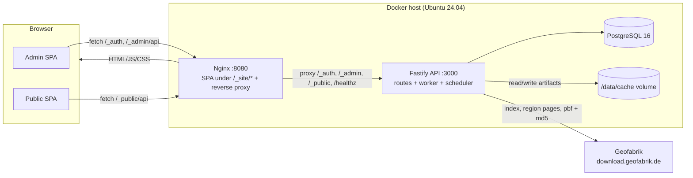
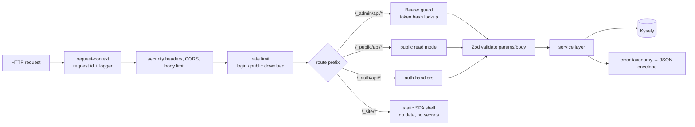
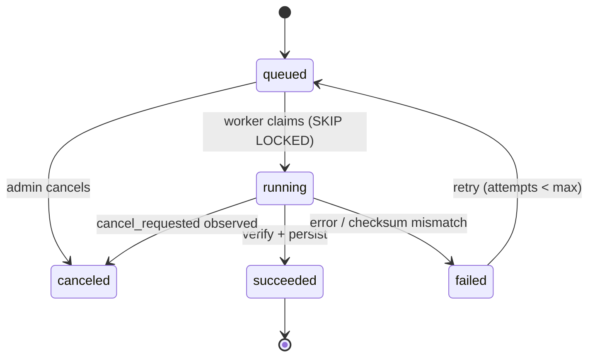
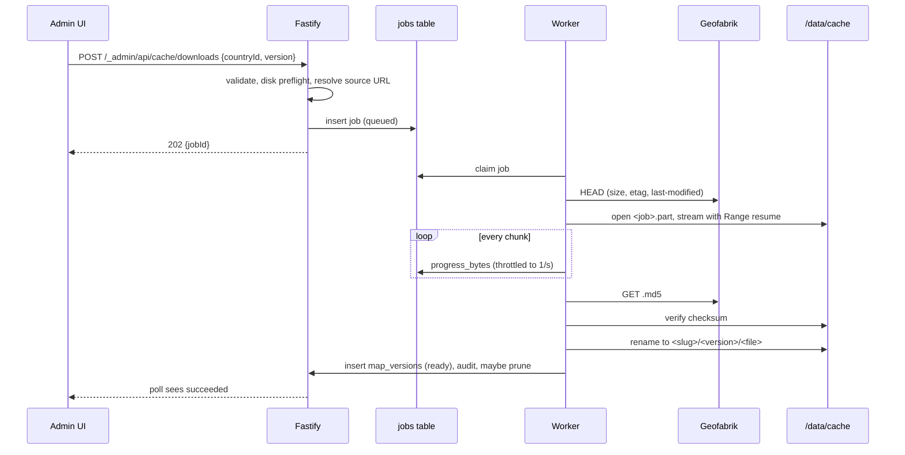

# 02 — Architecture

**TL;DR** — three containers (nginx, Fastify, Postgres); one process runs routes + a Postgres-backed job worker + the interval scheduler; files live on the `/data/cache` volume; Geofabrik is reached through a 4-method `MapSource`.

## 1. Shape of the system

Three runtime containers plus volumes. One codebase (Bun workspaces), one API process that also runs
the job worker and the scheduler.



**Why one API container:** the requirement is a small self-hosted mirror; a separate worker service
adds deployment and failure modes for no benefit at this scale (D-11). The worker is a loop inside
the same process, sharing the pool and the code, with `WORKER_ENABLED` to switch it off if the
operator ever wants a dedicated container.

## 2. Module boundaries

| Module | Owns | May not |
|---|---|---|
| `auth` | Admin credentials, token issue/verify/revoke, login throttling | Touch cache/files |
| `admin` | Admin JSON APIs (`/_admin/api/*`), orchestration of jobs | Stream files without going through `storage` |
| `public` | Published read model, public downloads, stats counters | Return unpublished data, mutate anything |
| `geofabrik` (MapSource) | Catalog fetch, region page parse, version discovery, HEAD/metadata | Write to DB or disk (returns facts only) |
| `jobs` | Queue, worker loop, job handlers, progress, cancellation | Contain HTTP concerns |
| `system` | CPU/RAM/disk sampling, disk preflight | Decide when to prune |
| `db` | SQL, repositories, transactions | Contain business rules that belong in modules |

Dependency direction: `modules/* → lib/* → db/*`. A module never imports another module's internals;
shared contracts live in `packages/shared` (Zod + types) used by both API and web.

## 3. Request path



- Validation happens **before** the service layer; handlers receive typed DTOs.
- Responses are Zod-typed too (`serializerCompiler` or explicit mappers); the OpenAPI/route docs in
  `04-api.md` mirror them.
- Errors always use one envelope: `{ error: { code, message, details?, requestId } }`.

## 4. Job system



- **Table as queue.** `jobs` rows with `status`, `priority`, `run_after`, `attempts`.
  Claiming uses:
  ```sql
  UPDATE jobs SET status='running', locked_by=$1, locked_at=now(), started_at=now(), attempts=attempts+1
  WHERE id = (
    SELECT id FROM jobs
    WHERE status='queued' AND run_after <= now()
    ORDER BY priority DESC, run_after ASC, created_at ASC
    FOR UPDATE SKIP LOCKED LIMIT 1
  ) RETURNING *;
  ```
- **Single worker loop** with `WORKER_CONCURRENCY` (default 2) — downloads are I/O-bound; two parallel
  transfers keep the UI responsive without saturating the NIC.
- **Ownership is a lock, not a timestamp.** Before working a job the worker takes
  `pg_try_advisory_lock(hashtext(job_id))` on its own connection and holds it until the job finishes.
  A timestamp cannot distinguish *crashed* from *slow*: a stalled network read can block a heartbeat
  for minutes while the transfer is still alive, and blindly requeueing would put two workers on the
  same `.part` file. With the advisory lock, the crash case is unambiguous — the lock disappears when
  the connection dies.
- **Heartbeats:** `locked_at` is refreshed by a timer (every 15 s, independent of the download loop) so
  the UI can show liveness. The reaper only *candidates* rows with `locked_at < now() - 5 min`; it
  requeues a row only if `pg_try_advisory_lock(hashtext(id))` **succeeds** (proof the old owner is gone)
  and releases it immediately. Otherwise it leaves the row alone.
- **Cancellation:** sets `cancel_requested = true`; the download loop checks it between chunks and
  between retries, deletes the `.part` file, and marks the job `canceled`.
- **Progress:** `progress_bytes`, `total_bytes`, `speed_bps`, `eta_seconds`, `phase`
  (`fetching_index | downloading | verifying | installing`). Polled by the UI (2 s) — no websockets
  needed for v1.
- **One active download per version.** A partial unique index on
  `((payload->>'countryId'), (payload->>'version'))` where `type='download'` and
  `status IN ('queued','running')` prevents duplicate transfers. `version` is the **requested** value
  (`latest` or a snapshot id), so two admins clicking "download latest" twice get one job; downloading
  `latest` and an explicit older snapshot at the same time stays possible.

## 5. Scheduler (intervals)

- A dedicated loop wakes every 30 s, selects `intervals` where `enabled` and `next_run_at <= now()`,
  and **claims each row** with `FOR UPDATE SKIP LOCKED` + immediate `next_run_at` recomputation in the
  same transaction — this is the double-fire guard (no external lock service needed).
- On fire, **one transaction** does all three: create the `interval_runs` row, enqueue one `download`
  job per country (`only_if_changed`), and advance `next_run_at`. If enqueueing fails, the transaction
  rolls back and the run is retried on the next tick — a claimed schedule can never lose its work.
- If a run for that interval is still `running` (a slow download from the previous occurrence), this
  occurrence is **skipped** with a logged `SKIPPED_OVERLAP` instead of violating the
  `interval_runs_one_active` index. Runs are never stacked.
- `next_run_at` is always computed in **UTC** from `frequency` + `time_of_day` (+ `weekday` for weekly,
  + `day_of_month` for monthly). `day_of_month` is restricted to **1…28 at the API and in the DB**, so
  every month has the day and no clamping is ever needed.
- Missed runs (server down at 03:00): the loop fires the run **once** when it comes back, then
  schedules the next occurrence — documented, no silent multi-run catch-up (INT-4).
- Schedule math lives in `lib/time.ts` and is unit-tested across DST-free UTC, month-ends, leap years.

## 6. Download pipeline



Key guarantees:

- **Empty shells never appear:** the DB row is created as `pending` and only becomes `ready` after
  the checksum matches and the rename succeeds.
- **Resume:** `.part` file kept on transient failures; retries send `Range: bytes=<size>-` and append.
  If the server ignores Range (`200`), the file is truncated and restarted — correct either way.
- **Disk preflight:** required = `content-length * 1.1`; refuses to start below
  `DISK_RESERVE_BYTES` (default 2 GiB) and reports the shortfall in the error message.
- **Upstream deletion:** if a dated snapshot returns `404`, the job fails with
  `SOURCE_VERSION_GONE` and the UI suggests `latest` — we never silently substitute a different file.

## 7. Update detection

`MapSource.getRegionDetail()` returns the current identity of the source file: the snapshot id offered
by the source (e.g. `261024`), the "contains data up to" timestamp, `content-length`, and
`etag`/`last-modified`. The decision is made in this order:

1. If the source's current snapshot id is already a cached version → `up_to_date`.
2. Else if the source's data timestamp is newer than the newest cached version's → `update_available`.
3. Else if the identity differs (size/etag changed while the timestamp is missing or equal) →
   `update_available` (conservative: better a redundant download than a missed update).
4. Else → `up_to_date`. Any failure to fetch or parse → `unknown`.

| Result | Meaning |
|---|---|
| `up_to_date` | Source identity equals the newest cached version |
| `update_available` | A newer source version exists; response carries version id, date, size |
| `unknown` | Source unreachable / parse failed → shown as "couldn't check", never as up to date |

Checks are cheap (one page fetch per country, cached for 10 minutes) so both the per-row button and
the bulk check are safe.

## 8. Source abstraction (thin on purpose)

```ts
/** A map data provider. Only the four operations the product needs. */
export interface MapSource {
  readonly id: 'geofabrik';
  listRegions(): Promise<SourceRegion[]>;
  getRegionDetail(regionId: string): Promise<SourceRegionDetail>;
  listSnapshots(regionId: string): Promise<SourceSnapshot[]>;
  resolveDownload(regionId: string, version: string | 'latest'): Promise<ResolvedDownload>;
}
```

No factory registry, no plugin loader, no provider config UI (D-1). Adding a provider later = one new
class implementing the interface + one line where it is constructed.

## 9. Failure behaviour

| Failure | Behaviour |
|---|---|
| Geofabrik unreachable | Catalog sync job fails; UI shows stale-catalog timestamp + retry; cached maps keep serving |
| Checksum mismatch | Job fails, `.part` deleted, no version created, admin sees the expected vs actual hash |
| Disk full | Preflight blocks new jobs; running job fails cleanly, `.part` removed, `DISK_LOW` alert widget |
| DB down | API returns `503` with `DB_UNAVAILABLE`; worker pauses; Nginx keeps serving nothing else |
| Process crash mid-download | Reaper requeues once the job's advisory lock is free; resume continues from `.part` (details: `05-flows.md` F12) |
| File missing for a `ready` version | Download returns `410 VERSION_FILE_MISSING` + audit entry; admin row shows "file missing" |
| Public toggle off mid-download | New requests get `404`; in-flight transfers finish (no broken pipes) |

## 10. Performance envelope (design targets)

| Path | Target |
|---|---|
| Catalog page (200 countries) | < 300 ms server time, < 1.5 MB payload (no geometry in responses) |
| Admin cache table | < 200 ms for 500 cached countries (indexed, joined counts) |
| Download throughput | Limited only by disk/NIC; streaming, 64 KiB chunks, no buffering in memory |
| Dashboard metrics | 1 sample / 10 s, 7-day retention, aggregated server-side for the chosen window |
| SPA first load (public) | ≤ 220 kB gzip JS for the first route, LCP < 2.5 s (Vuetify + Vue tree-shaken; admin routes lazy-loaded) |
