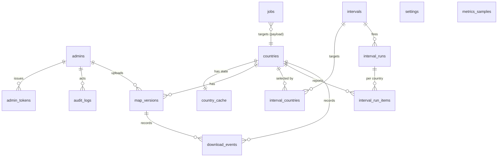

# 03 — Data model

**TL;DR** — 15 tables; `countries` ← `map_versions` (+ 1:1 `country_cache`); `jobs` is the queue; `intervals`/`interval_runs` hold scheduling; files are addressed by `<slug>/<version>/<file>`; versions are immutable and hard-deleted.

PostgreSQL 16. SQL migrations (`apps/api/src/db/migrations/0001_init.sql`), typed access via Kysely,
no ORM. Timestamps are `timestamptz` (UTC); ids are `gen_random_uuid()`.

**Migration 0001 must start with the extensions** (otherwise the trigram index below cannot be created):

```sql
CREATE EXTENSION IF NOT EXISTS pg_trgm;   -- country name search
CREATE EXTENSION IF NOT EXISTS unaccent;  -- "Türkiye" matches "turkiye"
```

`unaccent` is optional: if the image's PostgreSQL lacks it, the search index falls back to plain
`lower(name)` and the API keeps working (no migration failure, documented in `09-development.md`).

## 1. ERD



## 2. Tables

### 2.1 `admins`

```sql
CREATE TABLE admins (
  id            uuid PRIMARY KEY DEFAULT gen_random_uuid(),
  username      text NOT NULL,
  password_hash text NOT NULL,                 -- argon2id
  is_active     boolean NOT NULL DEFAULT true,
  last_login_at timestamptz,
  created_at    timestamptz NOT NULL DEFAULT now(),
  updated_at    timestamptz NOT NULL DEFAULT now()
);
CREATE UNIQUE INDEX admins_username_key ON admins (lower(username));
```

- Username is case-insensitive unique. One row in practice (D-4); no UI limit in the schema.
- Seed idempotently from `ADMIN_USERNAME`/`ADMIN_PASSWORD` by the launch script.

### 2.2 `admin_tokens` (opaque bearer tokens, D-3)

```sql
CREATE TABLE admin_tokens (
  id           uuid PRIMARY KEY DEFAULT gen_random_uuid(),
  admin_id     uuid NOT NULL REFERENCES admins(id) ON DELETE CASCADE,
  token_hash   bytea NOT NULL,                 -- sha256(token), 32 bytes
  token_prefix text NOT NULL,                  -- first 8 chars, for display/debug only
  expires_at   timestamptz NOT NULL,
  revoked_at   timestamptz,
  last_used_at timestamptz,
  user_agent   text,
  ip           inet,
  created_at   timestamptz NOT NULL DEFAULT now()
);
CREATE UNIQUE INDEX admin_tokens_hash_key ON admin_tokens (token_hash);
CREATE INDEX admin_tokens_admin_idx ON admin_tokens (admin_id, expires_at DESC);
```

- Token format: `mm_` + 43 chars base64url (256 bits). Only the hash is stored.
- Verification: hash the presented token, look up, reject if `revoked_at IS NOT NULL` or
  `expires_at <= now()`. `last_used_at` is updated at most once per minute (avoid write amplification).
- Password reset and "logout everywhere" revoke all rows for the admin.
- Startup housekeeping deletes rows expired > 30 days ago.

### 2.3 `countries` (catalog cache, local identity)

```sql
CREATE TABLE countries (
  id             uuid PRIMARY KEY DEFAULT gen_random_uuid(),
  source         text NOT NULL DEFAULT 'geofabrik',
  source_id      text NOT NULL,               -- e.g. 'europe/finland' (from index 'id')
  parent_id      text,                        -- e.g. 'europe'
  slug           text NOT NULL,               -- 'europe/finland' → 'finland'; used in URLs/paths
  name           text NOT NULL,
  iso_alpha2     text[] NOT NULL DEFAULT '{}',
  iso_other      text[] NOT NULL DEFAULT '{}',-- iso3166-2 codes
  source_pbf_url text,
  source_size_hint_bytes bigint,              -- from region page when available
  catalog_synced_at timestamptz NOT NULL DEFAULT now(),
  created_at     timestamptz NOT NULL DEFAULT now(),
  updated_at     timestamptz NOT NULL DEFAULT now(),
  CONSTRAINT countries_slug_fmt CHECK (slug ~ '^[a-z0-9][a-z0-9-]{0,63}$')
);
CREATE UNIQUE INDEX countries_source_key ON countries (source, source_id);
CREATE UNIQUE INDEX countries_slug_key ON countries (slug);
CREATE INDEX countries_name_trgm ON countries USING gin (name gin_trgm_ops);  -- needs pg_trgm
CREATE INDEX countries_iso_idx ON countries USING gin (iso_alpha2);
-- parent_id has no FK on purpose: it references the *source* hierarchy (an id string), and a parent
-- region may be absent from the local catalog until the next sync.
```

- `slug` must be globally unique because it is used in public URLs and filesystem paths. Collisions
  (e.g. two `georgia`s across continents) are resolved at sync time by prefixing the parent slug
  (`asia/georgia` → `asia-georgia`) and recorded in the audit log.
- Trigram index powers type-ahead search; ISO arrays power the flag/code display and filtering.

### 2.4 `country_cache` (1:1 cache + publication state)

```sql
CREATE TABLE country_cache (
  country_id            uuid PRIMARY KEY REFERENCES countries(id) ON DELETE CASCADE,
  is_public             boolean NOT NULL DEFAULT false,
  public_since          timestamptz,
  update_state          text NOT NULL DEFAULT 'unknown'
                          CHECK (update_state IN ('unknown','up_to_date','update_available')),
  available_version     text,                  -- source version id when an update exists
  available_size_bytes  bigint,
  available_at          timestamptz,           -- source data timestamp of that version
  update_checked_at     timestamptz,
  versions_ready_count  int NOT NULL DEFAULT 0, -- recomputed by the service in-transaction
  total_size_bytes      bigint NOT NULL DEFAULT 0,
  created_at            timestamptz NOT NULL DEFAULT now(),
  updated_at            timestamptz NOT NULL DEFAULT now()
);
CREATE INDEX country_cache_public_idx ON country_cache (is_public) WHERE is_public;
CREATE INDEX country_cache_update_idx ON country_cache (update_state)
  WHERE update_state = 'update_available';
```

- A row exists only once a country has at least one version (created with the first version); it is
  deleted when the last version is deleted (hard delete, D-7b).
- `versions_ready_count`/`total_size_bytes` are recomputed by the service in the **same transaction** as
  any version change (no triggers: explicit SQL is easier to test and to reason about). They are a
  cache for the admin table, never the source of truth — a repair query recomputes them on demand.

### 2.5 `map_versions`

```sql
CREATE TABLE map_versions (
  id               uuid PRIMARY KEY DEFAULT gen_random_uuid(),
  country_id       uuid NOT NULL REFERENCES countries(id) ON DELETE CASCADE,
  version          text NOT NULL,              -- '260101' | 'latest@2026-10-23T20:20:51Z' | upload label
  origin           text NOT NULL CHECK (origin IN ('geofabrik_snapshot','geofabrik_latest','upload')),
  source_url       text,                       -- where it came from (null for uploads)
  source_filename  text NOT NULL,
  data_timestamp   timestamptz,                -- OSM data freshness ('data up to')
  file_size_bytes  bigint NOT NULL,
  checksum_md5     text,
  checksum_sha256  text,
  storage_path     text NOT NULL,              -- relative to CACHE_DIR
  status           text NOT NULL DEFAULT 'pending'
                     CHECK (status IN ('pending','ready','failed')),
  failure_reason   text,
  job_id           uuid,
  uploaded_by      uuid REFERENCES admins(id),
  created_at       timestamptz NOT NULL DEFAULT now(),
  ready_at         timestamptz,
  CONSTRAINT mv_version_fmt CHECK (version ~ '^[A-Za-z0-9][A-Za-z0-9._@+-]{0,63}$'),
  CONSTRAINT mv_ready_needs_checksum CHECK (
    status <> 'ready' OR checksum_md5 IS NOT NULL OR checksum_sha256 IS NOT NULL
  ),
  CONSTRAINT mv_size_positive CHECK (status <> 'ready' OR file_size_bytes > 0),
  CONSTRAINT mv_unique_version UNIQUE (country_id, version)
);
CREATE INDEX mv_country_ready_idx ON map_versions (country_id, ready_at DESC)
  WHERE status = 'ready';
CREATE INDEX mv_status_idx ON map_versions (status) WHERE status <> 'ready';
```

- **Hard delete** (D-7b): deleting a version removes the row and its file. The durable record of what
  was deleted lives in `audit_logs` (action `version.delete`, with version, size and checksum in
  `metadata`) — the table keeps no tombstone column, so `mv_unique_version` correctly allows
  re-importing the same version later.
- Only `status='ready'` rows are ever served. `pending` means "a job owns this slot"; the fine-grained
  progress (`downloading → verifying → installing`) lives on the job's `phase`, not duplicated here — one
  state machine per concept.
- `mv_ready_needs_checksum` enforces the "no unverified files" rule in the database, not just in code.

#### Version identity

| Origin | `version` value | Uniqueness meaning |
|---|---|---|
| `geofabrik_snapshot` | `260101` (YYMMDD from the file name) | One row per dated snapshot — the archive of what upstream may later delete |
| `geofabrik_latest` | `latest@2026-10-23T20:20:51Z` | Each download of `latest` becomes a distinct immutable version keyed by the source data timestamp (fallback: `latest@<yyyymmdd-hhmmss>` of fetch time) |
| `upload` | admin text, default today `YYYY-MM-DD` | Must be unique per country; duplicates rejected (D-10) |

Why: upstream mutates `-latest.osm.pbf` in place and deletes dated files. Recording *what we actually
downloaded* (timestamp + hashes) is what makes "check for update" and "download a specific version"
truthful. `latest` requests resolve to the newest source snapshot; after download the stored version id
becomes explicit.

### 2.6 `jobs`

```sql
CREATE TYPE job_type AS ENUM ('download','import','update_check','catalog_sync','prune');
CREATE TYPE job_status AS ENUM ('queued','running','succeeded','failed','canceled');

CREATE TABLE jobs (
  id               uuid PRIMARY KEY DEFAULT gen_random_uuid(),
  type             job_type NOT NULL,
  status           job_status NOT NULL DEFAULT 'queued',
  priority         smallint NOT NULL DEFAULT 0,
  payload          jsonb NOT NULL,            -- typed per handler, validated on claim
  result           jsonb,
  error_code       text,
  error_message    text,
  phase            text,
  progress_bytes   bigint NOT NULL DEFAULT 0,
  total_bytes      bigint,
  speed_bps        bigint,
  attempts         smallint NOT NULL DEFAULT 0,
  max_attempts     smallint NOT NULL DEFAULT 3,
  run_after        timestamptz NOT NULL DEFAULT now(),
  cancel_requested boolean NOT NULL DEFAULT false,
  locked_by        text,
  locked_at        timestamptz,
  started_at       timestamptz,
  finished_at      timestamptz,
  created_by       uuid REFERENCES admins(id),
  created_at       timestamptz NOT NULL DEFAULT now()
);
CREATE INDEX jobs_claim_idx ON jobs (priority DESC, run_after) WHERE status = 'queued';
CREATE INDEX jobs_running_idx ON jobs (locked_at) WHERE status = 'running';
CREATE INDEX jobs_recent_idx ON jobs (created_at DESC);
CREATE UNIQUE INDEX jobs_one_active_download ON jobs ((payload->>'countryId'), (payload->>'version'))
  WHERE type = 'download' AND status IN ('queued','running');
```

- `payload` examples:
  - download: `{ countryId, version, origin, onlyIfChanged? }`
  - import: `{ uploadId, countryId, version, replace }`
  - update_check: `{ countryIds: [...] }`
  - prune: `{ countryId, keep }`

Country and version deletion are **synchronous** (a DB transaction plus an `unlink`), so they are not
jobs: a delete that is queued behind a 30-minute download would look broken in the UI.
- Retention: finished jobs older than `JOB_RETENTION_DAYS` (default 30) are pruned by housekeeping.

### 2.7 `intervals` + `interval_countries` + run history

```sql
CREATE TYPE interval_frequency AS ENUM ('daily','weekly','monthly');

CREATE TABLE intervals (
  id            uuid PRIMARY KEY DEFAULT gen_random_uuid(),
  name          text NOT NULL,
  frequency     interval_frequency NOT NULL,
  time_of_day   time NOT NULL DEFAULT '03:00',
  weekday       smallint CHECK (weekday BETWEEN 1 AND 7),          -- ISO, weekly only
  day_of_month  smallint CHECK (day_of_month BETWEEN 1 AND 28),    -- monthly only
  keep_versions smallint NOT NULL DEFAULT 3 CHECK (keep_versions >= 1),
  only_if_changed boolean NOT NULL DEFAULT true,
  enabled       boolean NOT NULL DEFAULT true,
  next_run_at   timestamptz NOT NULL,
  last_run_at   timestamptz,
  last_status   text,
  created_by    uuid REFERENCES admins(id),
  created_at    timestamptz NOT NULL DEFAULT now(),
  updated_at    timestamptz NOT NULL DEFAULT now(),
  CONSTRAINT intervals_shape CHECK (
    (frequency = 'daily')
    OR (frequency = 'weekly'  AND weekday IS NOT NULL)
    OR (frequency = 'monthly' AND day_of_month IS NOT NULL)
  )
);
CREATE INDEX intervals_due_idx ON intervals (next_run_at) WHERE enabled;

CREATE TABLE interval_countries (
  interval_id uuid NOT NULL REFERENCES intervals(id) ON DELETE CASCADE,
  country_id  uuid NOT NULL REFERENCES countries(id) ON DELETE CASCADE,
  PRIMARY KEY (interval_id, country_id)
);

CREATE TABLE interval_runs (
  id                uuid PRIMARY KEY DEFAULT gen_random_uuid(),
  interval_id       uuid NOT NULL REFERENCES intervals(id) ON DELETE CASCADE,
  triggered_by      text NOT NULL CHECK (triggered_by IN ('schedule','manual')),
  status            text NOT NULL DEFAULT 'running'
                      CHECK (status IN ('running','succeeded','partial','failed')),
  countries_total   int NOT NULL DEFAULT 0,
  countries_ok      int NOT NULL DEFAULT 0,
  countries_failed  int NOT NULL DEFAULT 0,
  countries_skipped int NOT NULL DEFAULT 0,
  bytes_downloaded  bigint NOT NULL DEFAULT 0,
  started_at        timestamptz NOT NULL DEFAULT now(),
  finished_at       timestamptz,
  error_message     text
);
CREATE INDEX interval_runs_interval_idx ON interval_runs (interval_id, started_at DESC);
-- The scheduler transaction is the primary double-fire guard; this index makes a second *running* row
-- for the same interval impossible even if the process restarts mid-run and a tick races the recovery.
CREATE UNIQUE INDEX interval_runs_one_active ON interval_runs (interval_id) WHERE status = 'running';

CREATE TABLE interval_run_items (
  id            uuid PRIMARY KEY DEFAULT gen_random_uuid(),
  run_id        uuid NOT NULL REFERENCES interval_runs(id) ON DELETE CASCADE,
  country_id    uuid REFERENCES countries(id) ON DELETE SET NULL,  -- keep history after deletion
  country_slug  text NOT NULL,          -- snapshot: survives the country being deleted
  country_name  text NOT NULL,          -- snapshot
  job_id        uuid,
  status        text NOT NULL DEFAULT 'queued'
                  CHECK (status IN ('queued','skipped','downloaded','failed')),
  version       text,
  bytes         bigint NOT NULL DEFAULT 0,
  error_code    text,
  error_message text
);
CREATE UNIQUE INDEX interval_run_items_unique ON interval_run_items (run_id, country_slug);
```

- `day_of_month` capped at **28** so monthly schedules exist in every month (no clamping surprises).
- Run status becomes `partial` when some countries succeed and others fail — surfaced in the UI as a
  warning, not a silent success.

### 2.8 `upload_sessions` (import staging)

```sql
CREATE TABLE upload_sessions (
  id            uuid PRIMARY KEY DEFAULT gen_random_uuid(),
  country_id    uuid NOT NULL REFERENCES countries(id) ON DELETE CASCADE,
  version       text NOT NULL,
  original_name text NOT NULL,
  temp_path     text NOT NULL,               -- under /data/tmp
  size_bytes    bigint NOT NULL DEFAULT 0,
  checksum_md5  text,
  status        text NOT NULL DEFAULT 'received'
                  CHECK (status IN ('received','installing','installed','failed','expired')),
  job_id        uuid,
  created_by    uuid REFERENCES admins(id),
  created_at    timestamptz NOT NULL DEFAULT now(),
  expires_at    timestamptz NOT NULL DEFAULT now() + interval '24 hours'
);
```

The HTTP multipart request only *stages* the file (validated: extension `.osm.pbf`, magic bytes
`\x0a\x0d`-style pbf check via first bytes, size limit, slug-safe name). Installation is a job so the
UI never blocks on a large upload.

### 2.9 `metrics_samples`

```sql
CREATE TABLE metrics_samples (
  sampled_at     timestamptz NOT NULL,
  cpu_percent    real,
  load1          real,
  load5          real,
  load15         real,
  mem_used_bytes bigint,
  mem_total_bytes bigint,
  disk_used_bytes bigint,
  disk_total_bytes bigint,
  cache_size_bytes bigint,
  PRIMARY KEY (sampled_at)
);
```

- One row / 10 s (≈ 60 k rows / week). Retention 7 days; older rows deleted hourly.
- The sampler writes with `INSERT … ON CONFLICT (sampled_at) DO NOTHING`: a restart inside the same
  second, or two API replicas, must not fail or duplicate samples.
- A downsample to 1-minute buckets can be added later without API changes.
- Scope: process/container metrics from `node:os` + `fs.statfs` on `CACHE_DIR`, documented in the UI.
- No host-level cAdvisor in v1 (keeps deployment to three containers).

### 2.10 `download_events` (usage + analytics)

```sql
CREATE TABLE download_events (
  id           bigserial PRIMARY KEY,
  country_id   uuid NOT NULL REFERENCES countries(id) ON DELETE CASCADE,
  version_id   uuid REFERENCES map_versions(id) ON DELETE SET NULL,
  channel      text NOT NULL CHECK (channel IN ('public','admin')),
  bytes_sent   bigint NOT NULL DEFAULT 0,
  ip_hash      text,            -- sha256(ip + salt), never the raw IP
  user_agent   text,
  created_at   timestamptz NOT NULL DEFAULT now()
);
CREATE INDEX download_events_country_idx ON download_events (country_id, created_at DESC);
```

- Recorded when a streaming download completes or is aborted (bytes actually sent).
- Powers public stats and the admin "most downloaded" widget; IPs are hashed (privacy by design).

### 2.11 `settings` + `audit_logs`

```sql
CREATE TABLE settings (
  key        text PRIMARY KEY,
  value      jsonb NOT NULL,
  updated_at timestamptz NOT NULL DEFAULT now()
);

CREATE TABLE audit_logs (
  id          bigserial PRIMARY KEY,
  actor_id    uuid REFERENCES admins(id) ON DELETE SET NULL,
  actor_name  text NOT NULL,          -- snapshot, survives admin deletion
  action      text NOT NULL,          -- 'auth.login', 'cache.publish', 'version.delete', ...
  target_type text,
  target_id   text,
  metadata    jsonb NOT NULL DEFAULT '{}',
  ip          inet,
  created_at  timestamptz NOT NULL DEFAULT now()
);
CREATE INDEX audit_logs_created_idx ON audit_logs (created_at DESC);
CREATE INDEX audit_logs_action_idx ON audit_logs (action, created_at DESC);
```

`settings` keys (initial): `branding.displayName`, `cache.keepVersions`, `cache.diskReserveBytes`,
`public.downloadsPerMinute`, `source.catalogTtlMinutes`, `source.baseUrl`, `privacy.ipHashSalt`
(generated on first boot; used only for hashed download IPs — never exposed by any endpoint).

## 3. Invariants (enforced in DB where possible, otherwise in service + tests)

1. `map_versions.file_size_bytes > 0` and `storage_path` starts with `<country.slug>/`.
2. A version may be `ready` only with a non-null checksum (enforced by `mv_ready_needs_checksum`).
3. `country_cache` exists ⇔ the country has ≥ 1 version row.
4. `is_public = true` requires ≥ 1 `ready` version (service-checked; toggling auto-closes on last delete).
5. Deleting a country deletes its versions, its cache row, its interval memberships, and its files.
6. `next_run_at` is always in the future after a scheduler claim commit.
7. Only one `queued|running` download job per `(countryId, version)`.

## 4. Migration strategy

- Forward-only numbered SQL files, applied by Kysely's migrator at boot (`migrateToLatest`) and by
  `scripts/migrate.ts` in CI/deploy.
- Every migration must be re-runnable on a fresh DB and safe on a populated one (additive first,
  backfills in a follow-up migration, destructive changes last).
- `schema.ts` (Kysely types) is updated **in the same commit** as the migration; a startup check
  compares migration count with an expected constant to catch version skew.

## 5. Sizing estimate

| Data | Rows | Notes |
|---|---|---|
| countries | ~400 | Geofabrik regions, refreshed daily |
| map_versions | tens–hundreds | 3 per cached country by default |
| jobs | ~1 k/month | pruned at 30 days |
| metrics_samples | ~60 k/week | pruned at 7 days; < 20 MB |
| download_events | grows with usage | nightly aggregate later if needed |

Disk is dominated by artifacts (737 MB for Finland, ~33 GB for Europe) — PostgreSQL stays tiny.
