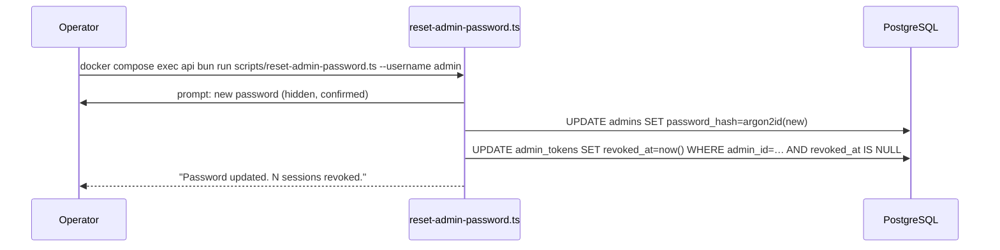
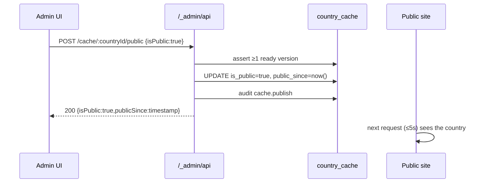
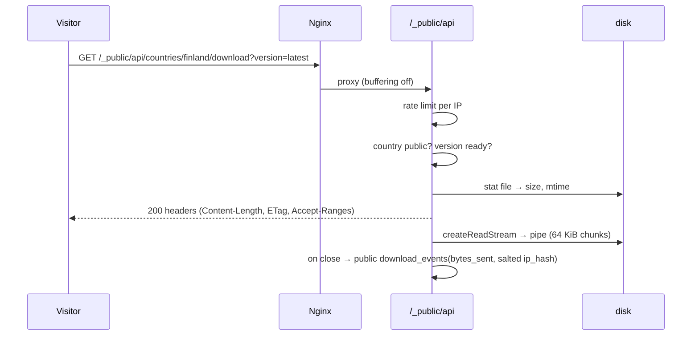
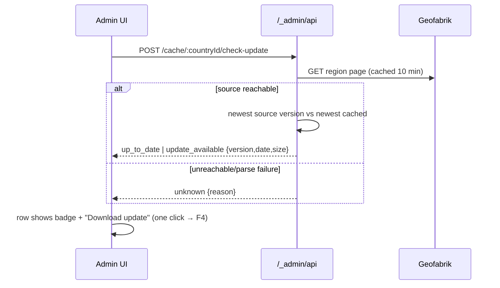
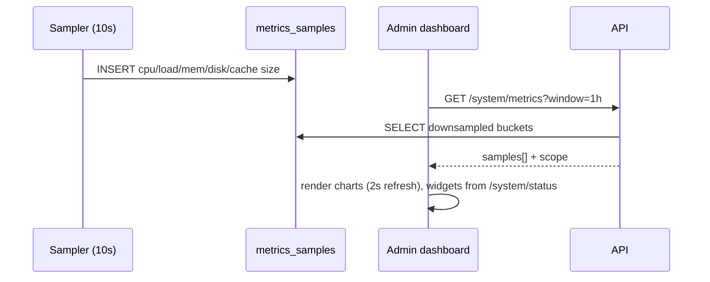

# 05 — Flows

**TL;DR** — 13 end-to-end sequences (bootstrap, login, reset, catalog sync, cache, delete, publish, public download, interval, update check, import, metrics, recovery), each with its invariants and the tests that pin them.

Sequence diagrams for every journey that matters. Each flow lists its **invariants** and the
**tests** that will pin it down.

---

## F1 — First boot & admin bootstrap (AUTH-1)

```mermaid
sequenceDiagram
  participant Op as Operator
  participant Entry as entrypoint.api.sh
  participant M as migrate
  participant I as init-admin.ts
  participant DB as PostgreSQL
  Op->>Entry: docker compose up -d (ADMIN_PASSWORD set on the first boot)
  Entry->>DB: wait for readiness (bun scripts/wait-for-db.ts, select 1, 60s deadline)
  Entry->>M: bun scripts/migrate.ts
  M->>DB: apply pending SQL migrations (serialised by the migrator's own lock)
  Entry->>I: bun scripts/init-admin.ts --bootstrap
  I->>DB: SELECT admin WHERE lower(username)=lower($ADMIN_USERNAME)
  alt no admin, password source present
    I->>DB: INSERT admin (argon2id hash) + auth.admin_created audit row
    I-->>Op: "admin 'admin' created (password from ADMIN_PASSWORD)" (never the password)
  else admin exists
    I-->>Op: "admin 'admin' already exists — unchanged." (no password needed)
  else no admin and no password source
    I-->>Entry: exit 1, "Set ADMIN_PASSWORD …"
    Entry-->>Op: "step 3/4 … failed (exit 1); the API is not started"
  end
  Entry->>Entry: exec bun apps/api/src/server.ts  (the API becomes PID 1)
```

Every step prints `entrypoint: step N/4: …` to stderr, and a failing step exits with **its own** status after
`… failed (exit N); the API is not started` — so `docker compose logs api` names the step. The wait is a real query
through the API's own pool rather than a port probe: a PostgreSQL that is recovering accepts TCP and answers `57P03`,
which a `pg_isready`-shaped loop cannot see, and the runtime image has no OS packages to run one with. `--bootstrap`
asks the database before it asks for a secret, because after the first boot there is nothing to create; on a fresh
volume with no password source it still refuses. Verified against a real PostgreSQL, pass 42: an empty volume boots to
`/readyz` `{"database":"ok","cache":"ok"}` and stops on `SIGTERM` with exit 0; a second boot with `ADMIN_PASSWORD`
unset prints `already exists — unchanged`; two entrypoints started at once against one empty database apply **one**
migration, create **one** admin, and neither fails.

**Rules:** password from `ADMIN_PASSWORD`, `ADMIN_PASSWORD_FILE`, or a hidden prompt (in that order — a flag is
deliberately absent, because an argument is visible in `ps` and in the shell's history); the creation policy of
`14-security.md` §3 applies (≥ 12 characters, not on the blocklist, no username inside it — enforced by
`modules/auth/password.ts`, `P1-AUTH-01`); never logged or echoed, on any stream; re-running never overwrites an
existing password (use the reset script, `P1-AUTH-07`) and never re-enables a deactivated account — it says so and
leaves it alone. The insert and its `auth.admin_created` audit row commit together, in
`modules/auth/admin-accounts.ts`, which is also where the reset script and a future "add admin" endpoint will get the
same rules.
**Tests:** `scripts/tests/init-admin.spec.ts` — create, idempotent re-run (including a different password and a
different case), `--bootstrap` on a second boot with no password, `--bootstrap` on a fresh database with no password →
exit 1 and **no** row, a deactivated account reported and left deactivated, weak password rejected with every rule
listed, missing source + non-interactive → one line and exit 1, the secret absent from both streams;
`scripts/tests/wait-for-db.spec.ts` — the deadline, the progress line every ten attempts, the masked DSN, an
unusable environment refused before it connects, and the four refusals it does **not** wait for (`3D000`, `28P01`,
`28000`, `42501`) against the three it does (`57P03`, `ECONNREFUSED`); `scripts/tests/entrypoint.spec.ts` — the four steps in order, `exec`
for the last one, the exit code of a failing step, the installed path and the `ENTRYPOINT` that names it, and the guide
documenting the same four commands in the same order; `scripts/tests/secret-prompt.spec.ts` — raw mode before reading, restored
afterwards, backspace/Ctrl-C/Ctrl-D/escape sequences; `apps/api/tests/integration/admin-accounts.spec.ts` — the
transaction (a forced audit failure leaves no account), the concurrent boot (one account, one audit row), a `23505`
that is not ours re-thrown.

---

## F2 — Login & authenticated admin session (AUTH-2, AUTH-3, D-13)

```mermaid
sequenceDiagram
  participant A as Admin browser
  participant SPA as Vue SPA
  participant API as /_auth/api
  participant DB as admin_tokens
  A->>SPA: open /_auth/login
  A->>SPA: username + password
  SPA->>API: POST /_auth/api/login
  API->>API: throttle check (ip, username) — no hash, no DB
  alt locked out
    API-->>SPA: 429 RATE_LIMITED + Retry-After
  else allowed
    API->>DB: lookup admin; verify argon2id (dummy hash if absent)
    alt wrong password or unknown user
      API->>DB: INSERT audit auth.login_failed
      API-->>SPA: 401 INVALID_CREDENTIALS (identical either way)
    else password correct
      alt account deactivated
        API-->>SPA: 403 ACCOUNT_DISABLED (not counted as a failure)
      else valid
        API->>DB: BEGIN — INSERT token (sha256 hash, expiresAt), last_login_at, audit auth.login
        API-->>SPA: { token, expiresAt, admin } (cache-control: no-store)
        SPA->>SPA: auth.signIn() → sessionStorage 'mapirror.session.token'
        SPA->>SPA: router → /_site/admin/
        SPA->>API: GET /_auth/api/me (Bearer) → profile for the topbar
      end
    end
  end
  SPA->>API: GET /_auth/api/me (Bearer)
  SPA->>API: GET /_admin/api/system/status (Bearer)
```

**Rules:** the session is held by one store (`apps/web/src/stores/auth.ts`, `P1-WEB-05`) — the token, the profile and
the expiry — and everything that asks "is anyone signed in?" asks it: the router's guard
(`createAppRouter({ hasSession })`), the API client (`token`/`clearToken`) and the screens. The token itself lives only in
`sessionStorage` (not `localStorage`), under one key — `mapirror.session.token` (`apps/web/src/auth/token-storage.ts`) —
and is **never** sent to a request that does not need it: `/_admin/api/*` and `/me`/`logout` get `Authorization: Bearer …`,
while `/login` and everything under `/_public/api/*` get no credential at all. The rule is keyed on the path
(`apps/web/src/api/client.ts`, `needsBearer`), not on a flag per call. A reload re-reads the key (that is all the store
carries over) and asks `/me` for the profile; the profile is deliberately not persisted, so nothing on screen describes a
session that is gone. `signOut()` sends the revoke **before** it clears, because the client reads the token while it
builds the request.
`401` anywhere ⇒ clear state + redirect to `/_auth/login`; `403 ACCOUNT_DISABLED` does the same, because a deactivated
account's token will never work again — it is the one non-`401` that ends a session (the other `403`, `FORBIDDEN`, is a
permission answer and leaves the session alone). Clearing and navigating belong to the client's policy, which fires only
when the request presented a token and only from an admin page; `GET /_auth/api/me` at boot has three outcomes, not two —
`session`, `signed-out`, and `unverified` when the question went unanswered, which keeps the session (an offline laptop
must not be signed out). No auto-refresh (D-3). Every `/_admin/api/*` request passes the Bearer
guard first (`P1-AUTH-05`): `onRequest`, before the body is parsed, no opt-out — so the SPA's `401` handling is one
branch for every admin call, not one per screen.
The form is the client half of the same contract: both fields are validated with the **shared** `LoginRequestSchema` — the
object the API parses — so a rule cannot differ between the two sides, and the three refusals a person can cause are
sentences, not codes: *"That username and password do not match."* (`INVALID_CREDENTIALS`), *"This account has been
deactivated."* (`ACCOUNT_DISABLED`) and *"Too many attempts."* with a live countdown from `details.retryAfterSeconds`
(`RATE_LIMITED`, which also disables the form until it lifts). A failed sign-in leaves the typed pair in place and the
session — if there was one — untouched.

**Tests:** login happy path, wrong password, unknown user, deactivated account, lockout (`429` with `Retry-After`),
expired token, revoked token, cookie-only rejected, `?token=` rejected, SPA guard redirects when `sessionStorage` is
empty or `/me` fails. The throttle is checked **before** the hash on purpose: a locked-out client costs a map lookup,
not a 64 MiB Argon2 verify.

---

## F3 — Catalog sync (GEO-1, P2-SRC-06)

```mermaid
sequenceDiagram
  participant T as TTL/manual trigger
  participant W as Job worker
  participant G as Geofabrik
  participant DB as PostgreSQL
  T->>DB: read system-owned source.catalogSyncedAt marker
  alt no valid marker or age >= CATALOG_TTL_MINUTES
    T->>DB: enqueue catalog_sync (manual requests always enqueue)
  else within TTL
    T-->>T: keep the cached catalog
  end
  W->>G: GET index-v1-nogeom.json (10 s deadline, job AbortSignal)
  G-->>W: JSON index
  W->>W: Zod-validate entire index before writes
  W->>DB: BEGIN; transaction advisory lock; load prior slugs
  loop every current region, source-id order
    W->>DB: UPSERT countries facts; preserve assigned slug
  end
  Note over W,DB: Do not delete records absent from this index
  W->>DB: INSERT catalog.sync audit row
  W->>DB: COMMIT all country rows and audit together
  W-->>T: succeeded + syncedCount
```

**Rules:** TTL is measured from `source.catalogSyncedAt`, written in the catalog transaction even for an empty index;
failed/canceled attempts that roll back do not refresh it, and job-history pruning does not erase it. The exact TTL
boundary is due; an already queued/running catalog job suppresses a second automatic trigger. The API route and CLI share
one enqueue operation under a transaction-scoped advisory lock, so simultaneous manual requests return the same active
job id and record the admin that created it. A manually requested job always fetches the index, even if it is fresh. The production worker
registers the catalog handler against the configured Geofabrik base URL. The source request is bounded and receives the
worker's cancellation signal; cancellation during writes rolls the transaction back. Every current region is upserted
with one shared `catalog_synced_at`; existing slugs are never rewritten, and records omitted upstream (including their
cache rows and map versions) are retained. The `catalog.sync` audit entry commits in the same transaction, so an audit
failure cannot leave an unaudited catalog update.

**Tests:** `apps/api/tests/integration/catalog-sync.spec.ts` — repeat sync updates facts without duplicate rows or slug
changes, removed cached country/version retained, audit action and metadata, audit failure rolls upserts back, TTL
success/failure/other-job and boundary behavior, and empty-catalog freshness; `apps/api/tests/integration/catalog-sync-route.spec.ts`
— auth, attribution, strict input, concurrent deduplication, running-job reuse and terminal replacement;
`scripts/tests/sync-catalog.spec.ts` — help/arguments, config failure and shared queue behavior;
`apps/api/tests/geofabrik-index.spec.ts` — configured index URL, validation, status safety, request deadline and prompt cancellation.

---

## F4 — Reset admin password (AUTH-4)



**Options:** `--generate` draws a 24-character password from an alphabet without lookalikes and prints it **once, after
the commit** (a run that fails prints nothing); `--password-stdin` for automation, refused when stdin is a terminal
because the terminal would echo it; no source at all means a hidden prompt, asked twice. There is deliberately **no**
`ADMIN_PASSWORD` fallback — a reset that reused the container's environment would put the `.env` value back, which is
the opposite of a reset — and no `--password` flag, which would be visible in `ps`.

**One transaction:** the new hash, `revoked_at` on every open token for that account, and the `auth.password_reset` audit
row (with `metadata.revokedTokens`) commit together, so a failure leaves the old password working *and* the sessions
alive — never one without the other. Another account's password and sessions are untouched; an already-revoked token
keeps its first `revoked_at`, so a second reset reports `0 sessions revoked` rather than claiming work it did not do. A
deactivated account can be reset and is **not** re-enabled (the script says so). A locked-out address stays locked out:
the login throttle lives in the API process's memory and expires on its own — the script runs in a different process and
cannot, and should not, reach into it.

**Tests:** old token stops working (401 `TOKEN_REVOKED` over HTTP), new password logs in, old password is rejected,
audit row `auth.password_reset` written once per reset with the revoked count, a password that breaks the policy
rejected with every reason listed, unknown username rejected before the password is asked for.

---

## F5 — Cache a country from the catalog (GEO-1…4, CACHE-1)

```mermaid
sequenceDiagram
  participant A as Admin UI
  participant API as /_admin/api
  participant Q as jobs
  participant W as Worker
  participant G as Geofabrik
  participant FS as /data/cache
  A->>API: GET /catalog?q=fin&cache=uncached
  API-->>A: rows with cache.cached=false → Download button
  A->>API: GET /catalog/regions/finland/snapshots
  API-->>A: current snapshots + cached flags; on outage, cached source versions only + sourceReachable=false
  alt moving latest selection
    A->>API: POST /cache/downloads {countryId, version: latest}
  else pinned offered date
    A->>API: POST /cache/:countryId/versions {version}
    API->>G: resolve and confirm snapshot is still offered (410 if gone)
  end
  API->>API: validate + statfs preflight (ceil(size × 1.1) + reserve)
  API->>Q: INSERT job (queued)
  API-->>A: 202 {jobId}
  loop every 2s
    A->>API: GET /jobs/:jobId
    API-->>A: progressBytes/totalBytes/speed/phase
  end
  W->>G: resolve PBF URL + bounded HEAD/.md5 metadata (cancellable)
  W->>FS: write .partial/<job>.part on CACHE_DIR with Range resume
  alt administrator cancels while running
    A->>API: POST /jobs/:jobId/cancel
    API->>Q: set cancel_requested (durable)
    API-->>A: 202 accepted
    loop every 250 ms
      W->>Q: poll cancel_requested on owned job
    end
    W-->>W: abort handler signal; wait for cooperative cleanup
    W->>FS: remove .partial/<job>.part
    W->>Q: mark canceled after cleanup
  else transfer completes
    W->>FS: verify exact known length + MD5
    W->>FS: atomic rename to finland/261023/…
    W->>Q: commit ready version + cache summary; worker records success {versionId}
  else checksum mismatch or disk write failure
    W->>FS: remove corrupt/full .part
    W->>Q: mark version failed; worker retries safely or becomes terminal
  end
```

**Invariants:** no `ready` row before MD5 verification + atomic rename; the ready transaction recomputes the country-cache
summary; no duplicate active job; disk preflight before enqueue; the preflight requires `ceil(content-length × 1.1)` plus
the configured reserve; queued cancellation is immediate; running cancellation leaves no `.partial/<job>.part` before its
terminal state. Cancellation targets ≤2 s for a cooperative handler; arbitrary blocking code is not forcibly interrupted.
**Tests:** P2-TST-02 exercises the worker's byte-identical happy path, valid Range + If-Range resume, and bad-sidecar
MD5 mismatch against the shared loopback fixture server. Server-ignored Range restart, invalid `Content-Range`,
cooperative cancellation, and simulated `ENOSPC` remain deterministic injected transport/writer cases in P2-JOB-05.
P2-TST-01 provides the local index, region pages, PBF bytes, metadata, ranges and MD5 sidecars; PostgreSQL-backed worker
cases are skipped when no fresh test database is available. Disk preflight is covered by P2-JOB-04, duplicate detection
and conflict translation by P2-JOB-07, and the route-level `409` by P2-API-04.

---

## F6 — Delete a country or a specific version (CACHE-3, CACHE-4)

```mermaid
sequenceDiagram
  participant A as Admin UI
  participant API as /_admin/api
  participant DB as PostgreSQL
  participant Q as jobs
  participant FS as storage
  A->>A: click Delete → ConfirmDialog (type slug)
  A->>API: DELETE /cache/:id?confirm=finland
  API->>DB: acquire per-country session advisory lock
  API->>DB: BEGIN; lock catalog row FOR UPDATE
  API->>DB: check active jobs (409 unless cancelJobs=true)
  opt cancelJobs=true
    API->>Q: request cooperative cancellation
    loop until terminal or 3 s deadline
      API->>DB: wait for cleanup-complete job status
    end
  end
  API->>DB: delete versions + cache row; audit cache.delete_country
  API->>DB: COMMIT
  API->>FS: unlink each validated file (idempotent)
  API->>DB: release advisory lock
  API-->>A: 204 → cache row disappears; catalog country remains
```

**Specific-version path:** `DELETE /cache/:countryId/versions/:versionId?confirm=true` uses the same per-country exclusive
lock, but refuses rather than cancels any queued/running country job. One transaction deletes the selected version, writes
`version.delete`, and recomputes the cache summary; the last version removes the cache row, while zero remaining ready
versions auto-unpublish even if pending/failed rows remain. After commit, only the selected safe file path is unlinked;
the lock remains held until cleanup completes.

**Rules:** DB first, files second (a failed unlink leaves a sweepable orphan, never a dangling row that looks valid).
The per-country advisory lock is shared with download admission and remains held across the commit and file cleanup, so a
new worker cannot install into a path while it is being unlinked. The admin and public stream routes (P2-API-09/P3-API-05) hold the matching shared lock before opening a file and for
the full response lifetime, so deletion cannot unlink an active transfer's file. All cache paths and unlinks go through
`modules/storage/storage.ts`: parent symlinks are never followed, only a named file or encountered link component is
unlinked, and directories are never recursively deleted. A file-unlink failure is logged for the orphan sweep but does
not change the committed `204`. The catalog row remains; P4-INT-01 must add cleanup for interval memberships when that
table is introduced. Deleting the last version auto-unpublishes. Public URLs for deleted versions ⇒ `404`.
**Tests:** typed confirmation and audit, cache removal while catalog identity remains, queued cancellation, running-job
cleanup timeout leaves files intact, unlink failure leaves a sweepable orphan while retaining `204`, and download-enqueue
serialization against deletion.

---

## F7 — Publish / unpublish a country (PUB-1…4, D-9)



For `{isPublic:false}`, the response is `200 {isPublic:false,publicSince:null}`; the cache and versions remain intact.
Only actual visibility transitions create an audit row (`cache.publish` or `cache.unpublish`), committed atomically with the
cache update and carrying the before/after state.

**Rules:** publish without a ready version ⇒ `422 NO_READY_VERSION`; unpublish never deletes data.
**Tests:** publish/unpublish visible immediately in `/_public/api/countries`, `422` case, atomic audit rows,
`404` for unpublished country detail.

---

## F8 — Public download (WEB-3, D-9)



**Rules:** `404` (not `403`) for anything not published; `Range` supported; no full-file buffering in
memory; completed and aborted body transfers are recorded with bytes actually sent. The normalized IP is
hashed with the persisted/configured salt; its raw value is never stored. `HEAD` and `304` return no body
and create no event. Stats count public-channel rows only; their aggregates contain no identifiers. See
`04-api.md` §3.5 for the count/size window definitions.
**Tests:** 200 + exact bytes, 206 with `Range`, 304 with matching `ETag`, 404 unpublished, 410 when the
file was removed manually, rate limit `429`, `HEAD` returns no body and neither `HEAD` nor `304` records an event.

---

## F9 — Auto-download interval (INT-1…5)

```mermaid
sequenceDiagram
  participant S as Scheduler loop
  participant DB as PostgreSQL
  participant Q as jobs
  participant W as Worker
  S->>DB: BEGIN; SELECT intervals WHERE enabled AND next_run_at<=now() FOR UPDATE SKIP LOCKED
  S->>DB: INSERT interval_runs + enqueue jobs + UPDATE next_run_at = computeNext(...)
  S->>DB: COMMIT   (all-or-nothing; a failed enqueue rolls back and retries next tick)
  W->>W: run jobs, update interval_run_items
  W->>DB: recompute run status (succeeded/partial/failed)
  W->>DB: prune old versions (keep = interval.keep_versions, keep newest)
```

**Rules:** one claim per interval per tick; a still-running previous occurrence makes this one skip
(`SKIPPED_OVERLAP`, never stacked); missed runs fire once on recovery; run status `partial` when some
countries fail; pruning never removes the newest valid version.
**Tests:** next-run math (daily/weekly/monthly, month-end, Feb 28), no double-fire under concurrent
ticks, `only_if_changed` skips unchanged, partial failure reporting, prune keeps newest 3 and never 0.

---

## F10 — Update detection (UPD-1…4, L11)



**Rules:** `unknown` is never rendered as "up to date"; bulk check runs as a job; `update_checked_at`
persisted per country; dashboard shows "N updates available".
**Tests:** newer snapshot detected, unchanged source stays `up_to_date`, network error → `unknown`,
bulk job result aggregation, badge persists after reload.

---

## F11 — Import a map file (Section 12, D-10)

```mermaid
sequenceDiagram
  participant A as Admin UI
  participant API as /_admin/api/imports
  participant TMP as /data/tmp
  participant Q as jobs
  participant DB as PostgreSQL
  A->>API: POST multipart {file, countryId, version, replace?}
  API->>API: extension + allowed MIME + OSMHeader BlobHeader + size + version format
  alt duplicate without allowed confirmed replacement
    API-->>A: 409 VERSION_DUPLICATE + replaceAllowed
  else existing ready/failed version and replace=true
    API->>API: accept replacement; keep old row/artifact until install succeeds
  end
  API->>TMP: stream to generated UUID .osm.pbf path
  API->>Q: transactionally insert upload session + import job
  API-->>A: 202 {uploadId, jobId}
  Q->>Q: stream + compute MD5 into cache .partial/<job>.part
  alt initial import
    Q->>Q: reserve pending map version
  else confirmed replacement
    Q->>Q: keep existing version row and artifact unchanged
  end
  Q->>Q: atomically install part
  Q->>DB: transactionally finalize version row + session installed + refresh cache totals
  A->>API: GET /_admin/api/imports/:uploadId
  API-->>A: status + size + checksum + safe job error
  A->>A: row appears under the country with origin=upload
```

**Rules:** exactly three required fields (file/country/version); uploads never overwrite silently;
temp file removed on rejection/expiry (24 h) and after install. The worker verifies staged size while computing MD5,
installs only through the cache storage boundary, and commits `map_versions=ready`, `upload_sessions=installed`, and
`country_cache` aggregates in one transaction. On initial import failure, staging/partial/installed artifacts are
cleaned before the worker writes a terminal state and no ready row is left. A duplicate returns `409 VERSION_DUPLICATE`
with `replaceAllowed`; only a ready/failed version without active work may be replaced by resubmitting with explicit
`replace=true`. The old row/artifact remains unchanged until the new artifact is installed and the version row is
atomically recreated; a previously ready artifact stays served throughout, and failed replacement preserves the old version. Retryable failures remain eligible for worker
retry. Queued import cancellation removes staging before terminal state; running cancellation waits for handler cleanup.
`GET /_admin/api/imports/:uploadId` exposes a strict status projection and safe job errors. The S10 form searches the synced country catalog, accepts an `.osm.pbf` by drop or file picker, and keeps the form to exactly file/country/version; after client validation it preflights existing versions, asks for a separate explicit confirmation before any replacement upload, reports multipart byte progress, then follows the accepted job in the persistent progress drawer.
**Tests:** Web validation, duplicate preflight/confirmation, multipart progress and job-follow flow; PostgreSQL initial success/install-failure, confirmed replacement success and preservation on replacement failure,
status read, duplicate confirmation semantics, download-enqueue conflicts, and `latest` import/download conflicts; wrong
extension/header `415`, oversized `413`, invalid fields `400`, and temp cleanup.

---

## F12 — Dashboard monitoring (MON-1…3)



**Rules:** charts show real samples or an explicit "no data yet" state; sampling failure never crashes
the API; retention 7 days.
**Tests:** sampler writes rows, window downsampling shape, empty-window response, retention cleanup.

---

## F13 — Recovery & housekeeping

| Trigger | Action |
|---|---|
| `running` job with `locked_at` older than 4 min 30 s **and** advisory lock acquirable (reaper scans every 15 s) | Proof the owner is gone → requeue with exponential backoff if attempts remain, else `failed` with `WORKER_LOST`. A slow job that still holds its lock is left untouched; 15 s remains for scan processing within the 5 min target |
| Running interval with a still-running previous occurrence | Skip the occurrence (`SKIPPED_OVERLAP`), keep the schedule intact |
| `interval_runs` stuck in `running` (crash mid-run) | The `interval_runs_one_active` unique index would block every future run of that interval, so the reaper closes runs older than 6 h as `failed` with `RUN_INTERRUPTED` — without it, one crash silently disables a schedule |
| `.part` older than 24 h with no job | Delete |
| Orphan file/dir under `CACHE_DIR` with no `ready` row | Reported in `/_admin/api/system/status` → `storage.orphans`, deleted only by an explicit admin action or the scheduled sweep |
| `ready` row whose file is missing | Mark the version `failed` with `VERSION_FILE_MISSING`, close publication if it was the only version |
| Expired `upload_sessions` | Delete temp files + rows; skip sessions whose import job is `installing` |
| Old finished `jobs` | Delete beyond `JOB_RETENTION_DAYS` |
| Old `metrics_samples` | Delete beyond 7 days |
| Expired `admin_tokens` | Delete beyond 30 days past expiry |

Housekeeping runs once after the API starts listening and every 15 minutes thereafter. Each bounded pass deletes at most
100 expired upload sessions and skips any session currently installing; shutdown stops the timer and waits for the active
pass before closing the database pool.
