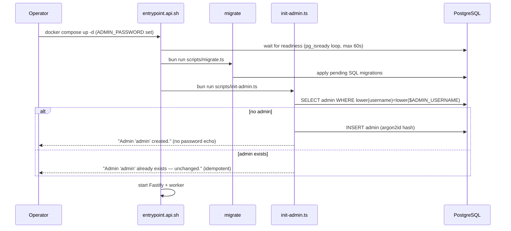
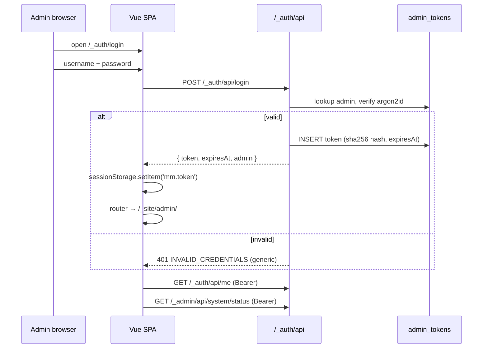
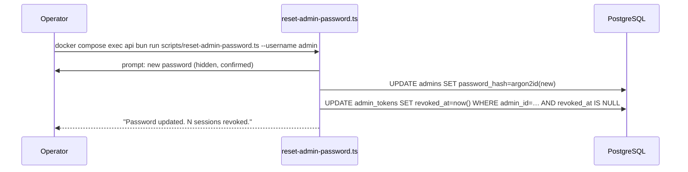
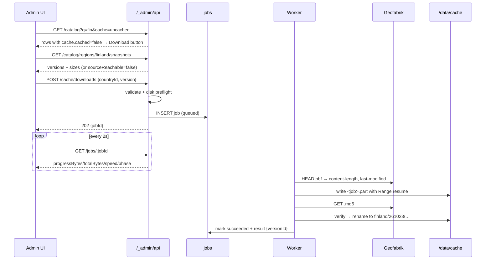
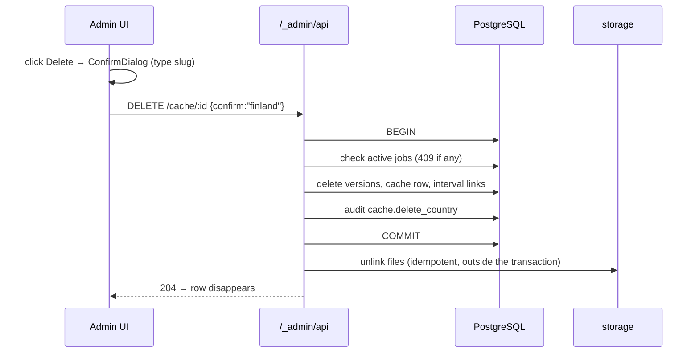
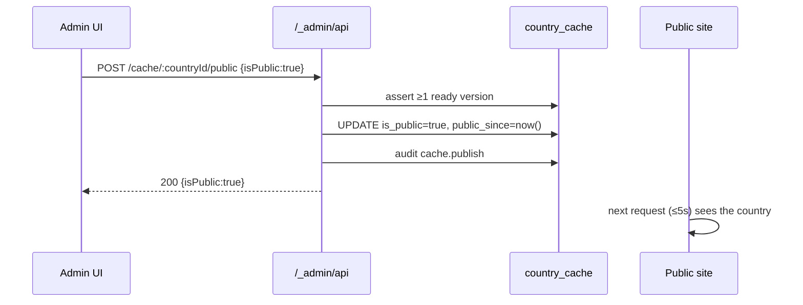
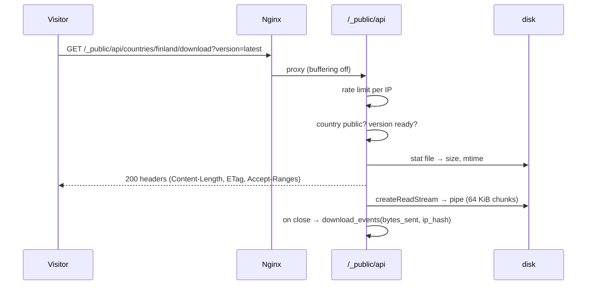
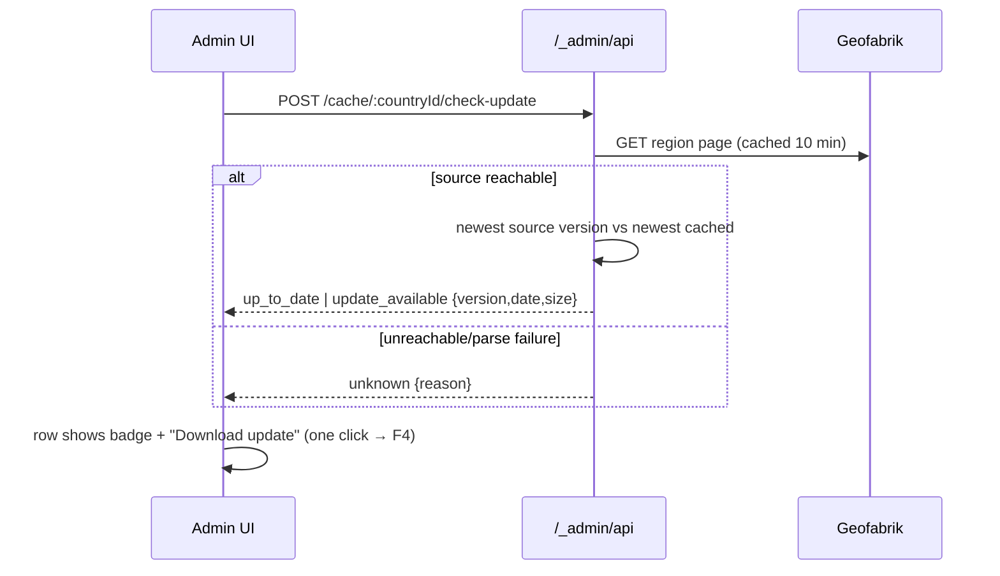
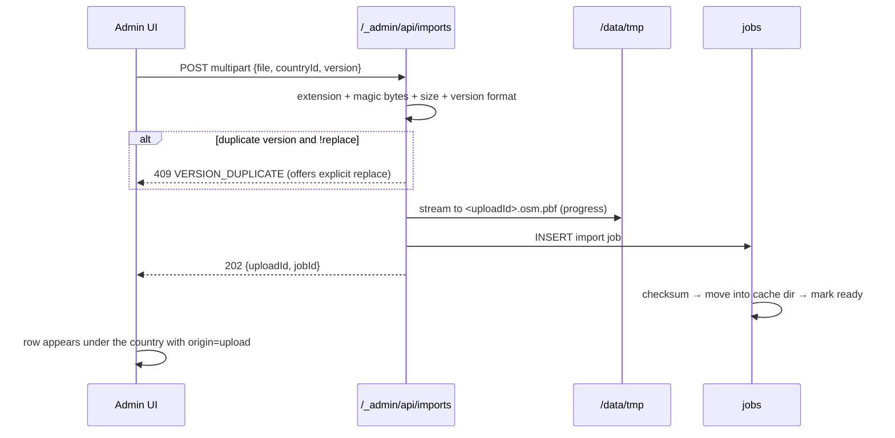
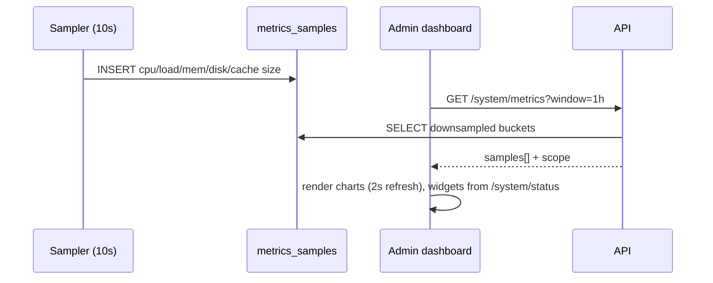

# 05 — Flows

**TL;DR** — 12 end-to-end sequences (bootstrap, login, reset, cache, delete, publish, public download, interval, update check, import, metrics, recovery), each with its invariants and the tests that pin them.

Sequence diagrams for every journey that matters. Each flow lists its **invariants** and the
**tests** that will pin it down.

---

## F1 — First boot & admin bootstrap (AUTH-1)



**Rules:** password from `ADMIN_PASSWORD`, `ADMIN_PASSWORD_FILE`, or hidden prompt; the creation policy of
`14-security.md` §3 applies (≥ 12 characters, not on the blocklist, no username inside it — enforced by
`modules/auth/password.ts`, `P1-AUTH-01`); never logged; re-running never overwrites an existing password (use
the reset script).
**Tests:** `scripts/tests/init-admin.spec.ts` — create, idempotent re-run, weak password rejected,
missing env + non-interactive → clear error, exit code 1.

---

## F2 — Login & authenticated admin session (AUTH-2, AUTH-3, D-13)



**Rules:** token only in `sessionStorage` (not `localStorage`); every API call attaches the header;
`401` anywhere ⇒ clear state + redirect to `/_auth/login`; no auto-refresh (D-3).
**Tests:** login happy path, wrong password, expired token, revoked token, cookie-only rejected,
`?token=` rejected, SPA guard redirects when `sessionStorage` is empty or `/me` fails.

---

## F3 — Reset admin password (AUTH-4)



**Options:** `--generate` prints a strong password **once**; `--password-stdin` for automation.
**Tests:** old token stops working, new password logs in, audit row `auth.password_reset` written,
password that breaks the policy rejected (with every reason listed, not one per attempt).

---

## F4 — Cache a country from the catalog (GEO-1…4, CACHE-1)



**Invariants:** no `ready` row before checksum + rename; no duplicate active job; disk preflight
before enqueue; cancel removes `.part`.
**Tests:** happy path with a fixture HTTP server, resume after mid-stream abort, checksum mismatch
fails cleanly, disk-full refuses with `503`, cancel leaves no files, duplicate request → `409`.

---

## F5 — Delete a country or a specific version (CACHE-3, CACHE-4)



**Rules:** DB first, files second (a failed unlink leaves a sweepable orphan, never a dangling row that
looks valid). Deleting the last version auto-unpublishes. Public URLs for deleted versions ⇒ `404`.
**Tests:** country delete, last-version delete closes public, file-unlink failure reports an orphan
without 500-ing the API, in-flight job blocks deletion.

---

## F6 — Publish / unpublish a country (PUB-1…4, D-9)



**Rules:** publish without a ready version ⇒ `422`; unpublish never deletes data; every toggle audited.
**Tests:** publish/unpublish visible immediately in `/_public/api/countries`, `422` case, audit rows,
`404` for unpublished country detail.

---

## F7 — Public download (WEB-3, D-9)



**Rules:** `404` (not `403`) for anything not published; `Range` supported; no full-file buffering in
memory; aborted transfers still recorded (client disconnect → record bytes actually sent); `HEAD`
returns headers without creating a `download_events` row.
**Tests:** 200 + exact bytes, 206 with `Range`, 304 with matching `ETag`, 404 unpublished, 410 when the
file was removed manually, rate limit `429`, `HEAD` returns no body.

---

## F8 — Auto-download interval (INT-1…5)

```mermaid
sequenceDiagram
  participant S as Scheduler loop
  participant DB as PostgreSQL
  participant Q as jobs
  participant W as Worker
  S->>DB: BEGIN; SELECT intervals WHERE enabled AND next_run_at<=now() FOR UPDATE SKIP LOCKED
  S->>DB: INSERT interval_runs + enqueue jobs + UPDATE next_run_at = computeNext(...)
  S->>DB: COMMIT   (all-or-nothing; a failed enqueue rolls back and retries next tick)
  W->>W: run jobs, update interval_run_items
  W->>DB: recompute run status (succeeded/partial/failed)
  W->>DB: prune old versions (keep = interval.keep_versions, keep newest)
```

**Rules:** one claim per interval per tick; a still-running previous occurrence makes this one skip
(`SKIPPED_OVERLAP`, never stacked); missed runs fire once on recovery; run status `partial` when some
countries fail; pruning never removes the newest valid version.
**Tests:** next-run math (daily/weekly/monthly, month-end, Feb 28), no double-fire under concurrent
ticks, `only_if_changed` skips unchanged, partial failure reporting, prune keeps newest 3 and never 0.

---

## F9 — Update detection (UPD-1…4, L11)



**Rules:** `unknown` is never rendered as "up to date"; bulk check runs as a job; `update_checked_at`
persisted per country; dashboard shows "N updates available".
**Tests:** newer snapshot detected, unchanged source stays `up_to_date`, network error → `unknown`,
bulk job result aggregation, badge persists after reload.

---

## F10 — Import a map file (Section 12, D-10)



**Rules:** exactly three required fields (file/country/version); uploads never overwrite silently;
temp file removed on failure/expiry (24 h).
**Tests:** success, duplicate rejected, replace accepted after confirmation, wrong extension `415`,
oversized `413`, temp cleanup on failure.

---

## F11 — Dashboard monitoring (MON-1…3)



**Rules:** charts show real samples or an explicit "no data yet" state; sampling failure never crashes
the API; retention 7 days.
**Tests:** sampler writes rows, window downsampling shape, empty-window response, retention cleanup.

---

## F12 — Recovery & housekeeping

| Trigger | Action |
|---|---|
| Stale `running` job (lock > 5 min) **and** advisory lock acquirable | Proof the owner is gone → requeue if attempts remain, else `failed` with `WORKER_LOST`. A slow job that still holds its lock is left untouched |
| Running interval with a still-running previous occurrence | Skip the occurrence (`SKIPPED_OVERLAP`), keep the schedule intact |
| `interval_runs` stuck in `running` (crash mid-run) | The `interval_runs_one_active` unique index would block every future run of that interval, so the reaper closes runs older than 6 h as `failed` with `RUN_INTERRUPTED` — without it, one crash silently disables a schedule |
| `.part` older than 24 h with no job | Delete |
| Orphan file/dir under `CACHE_DIR` with no `ready` row | Reported in `/_admin/api/system/status` → `storage.orphans`, deleted only by an explicit admin action or the scheduled sweep |
| `ready` row whose file is missing | Mark the version `failed` with `VERSION_FILE_MISSING`, close publication if it was the only version |
| Expired `upload_sessions` | Delete temp files + rows |
| Old finished `jobs` | Delete beyond `JOB_RETENTION_DAYS` |
| Old `metrics_samples` | Delete beyond 7 days |
| Expired `admin_tokens` | Delete beyond 30 days past expiry |
