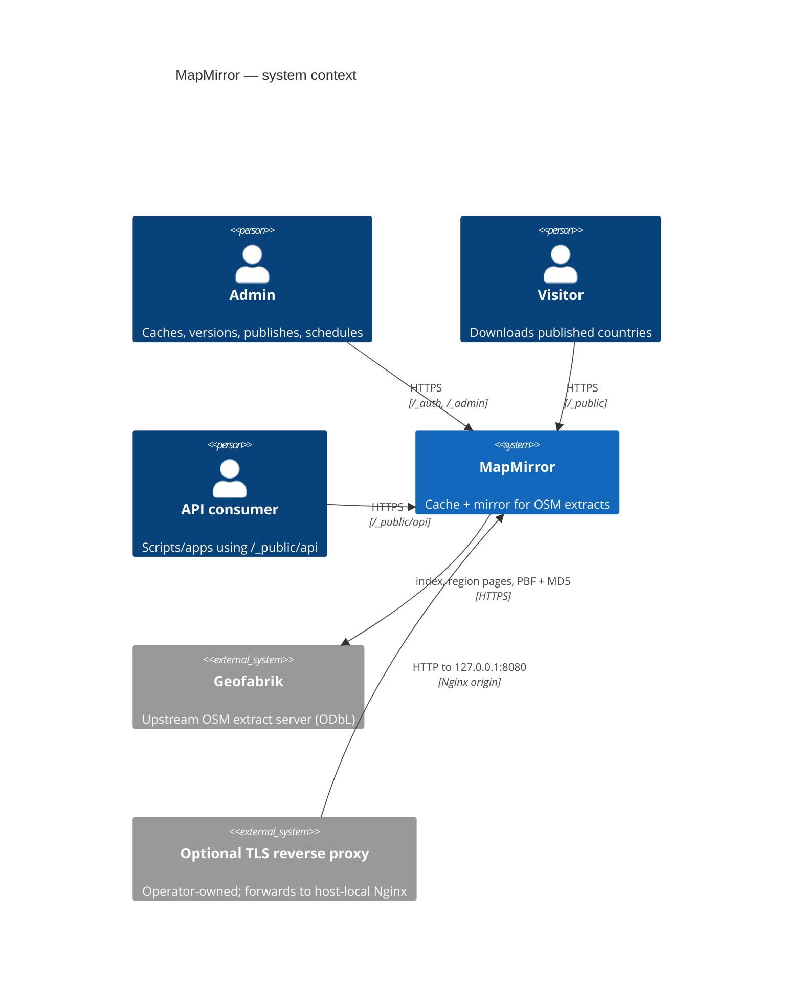
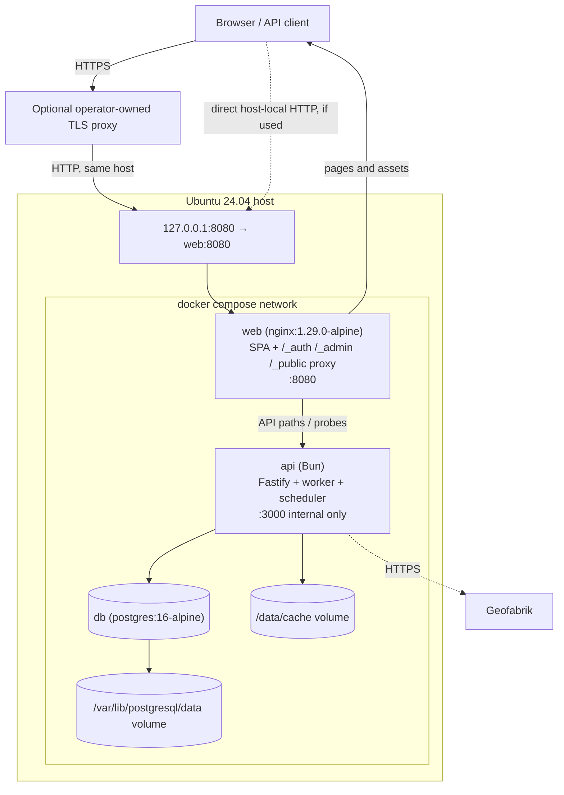
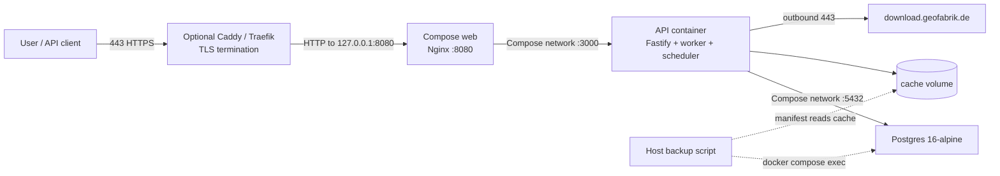
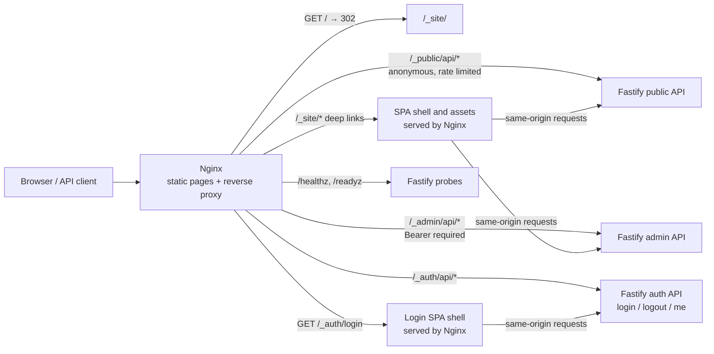
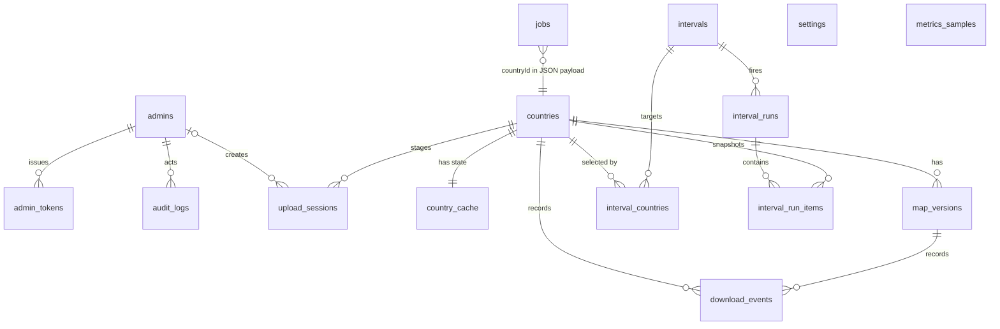
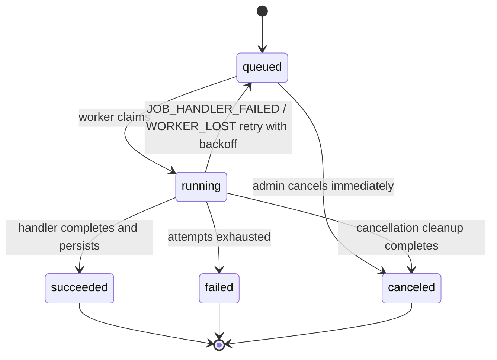
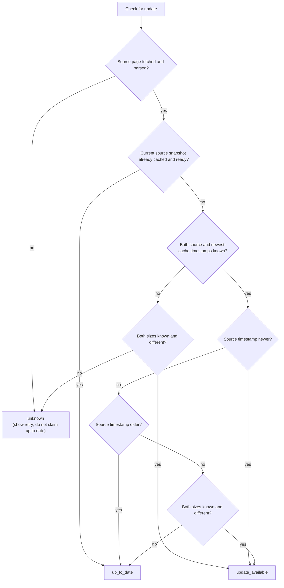
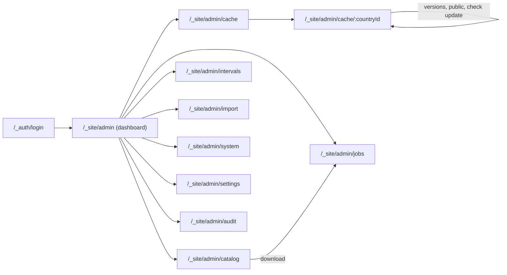
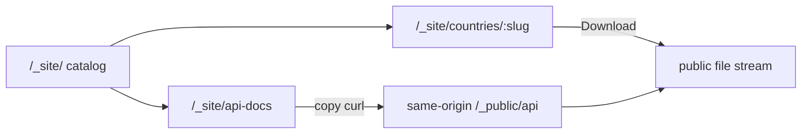

# 06 — Diagrams

All diagrams are Mermaid and render on GitHub. Update them with the code they describe.

## 1. System context



The optional TLS proxy runs on the same host in the default Compose setup. The web container is published only on
`127.0.0.1:8080`; the API and PostgreSQL ports are not published to the host.

## 2. Container view



## 3. Deployment on Ubuntu 24.04



Compose publishes the web service as `127.0.0.1:8080:8080` by default. For a TLS proxy on another host, bind the web
service to the server's private interface and restrict access at the network firewall; do not assume a host firewall
alone protects a Docker-published port.

## 4. API namespace map



## 5. Data model (compact)



`jobs` identify country targets in a JSON payload rather than a foreign key. `settings` stores configuration markers;
`metrics_samples` stores bounded dashboard history. Full DDL: [`03-data-model.md`](03-data-model.md).

## 6. Job state machine



A running cancellation request does not change the durable job status immediately: the owner observes it, aborts the
handler, waits for cooperative cleanup, then marks the job canceled. `WORKER_LOST` either requeues with backoff or
becomes terminal after attempts are exhausted.

## 7. Cache lifecycle per country

```mermaid
stateDiagram-v2
  [*] --> Uncached
  Uncached --> Cached : first download or import becomes ready
  Cached --> Published : admin publishes (requires a ready version)
  Published --> Cached : admin unpublishes
  Cached --> Cached : add version / retention prune / update
  Cached --> Uncached : delete cache or last version row
  Published --> Uncached : delete cache
  Published --> Cached : last ready version removed; auto-unpublish
```

Deleting the cache preserves the catalog country but removes its interval memberships. Deleting the last ready version
closes publication even if pending or failed version rows remain.

## 8. Update check decision



## 9. Interval scheduling timeline (daily 03:00 UTC)

```mermaid
gantt
  title Daily interval with keep=3
  dateFormat  YYYY-MM-DD HH:mm
  axisFormat  %m-%d %H:%M
  section Scheduled
  03:00 run (261023 kept) :2026-10-23 03:00, 5m
  03:00 run (261024 added) :2026-10-24 03:00, 5m
  03:00 run               :2026-10-25 03:00, 5m
  section Retention
  prune to newest 3        :2026-10-24 03:05, 1m
```

## 10. Admin SPA navigation



## 11. Public SPA navigation


