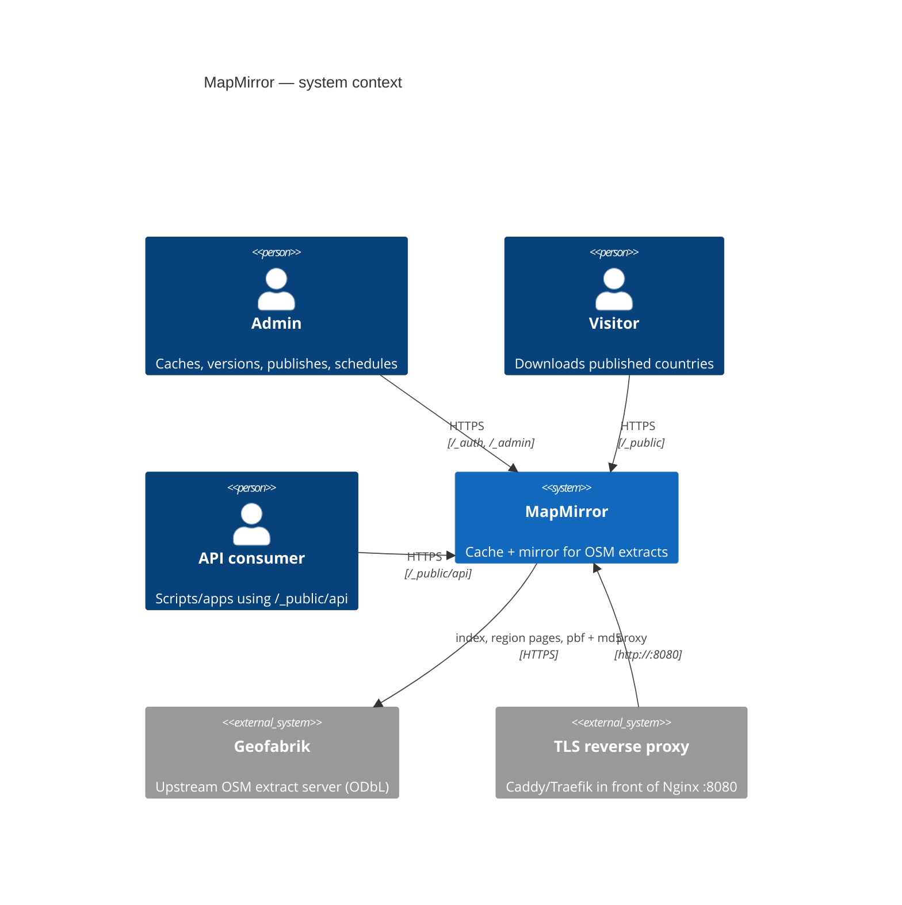
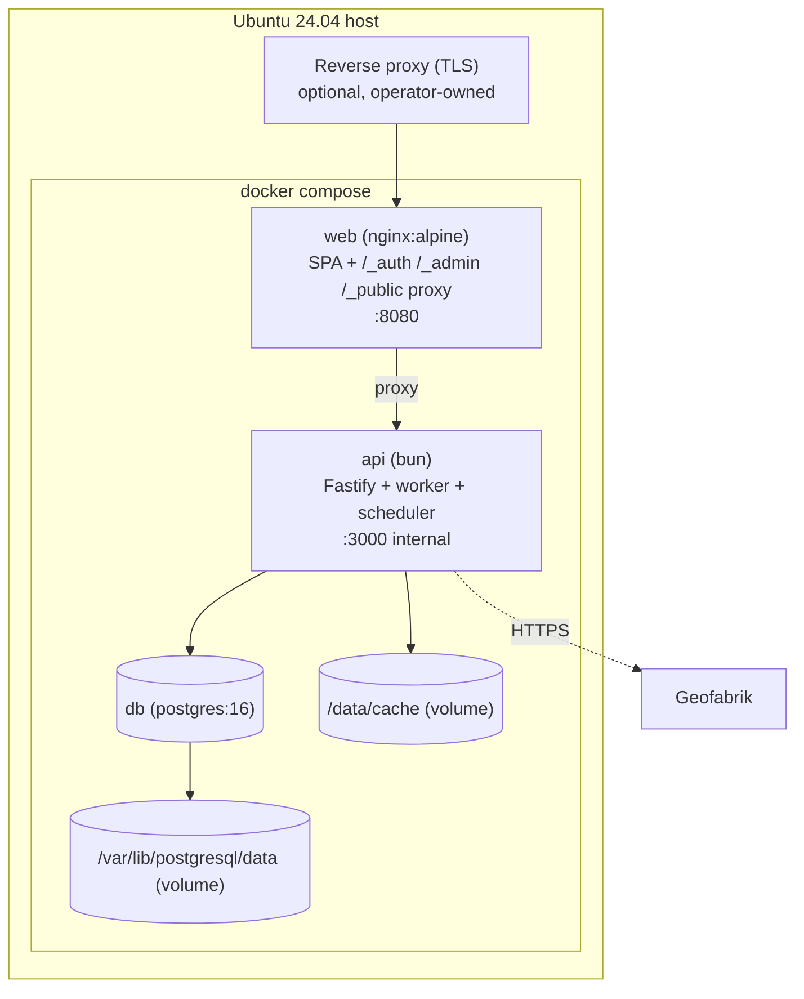
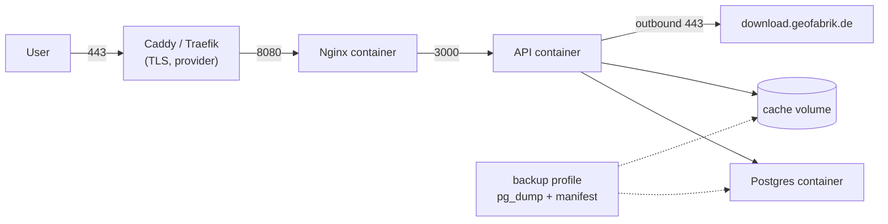
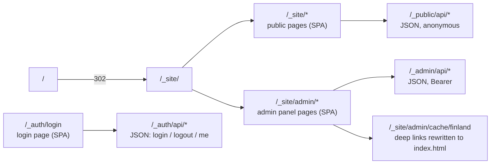
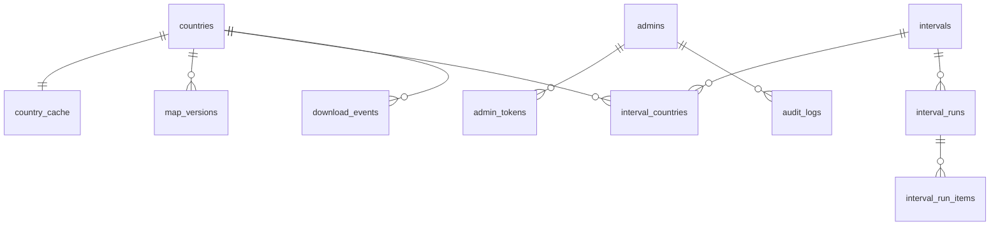
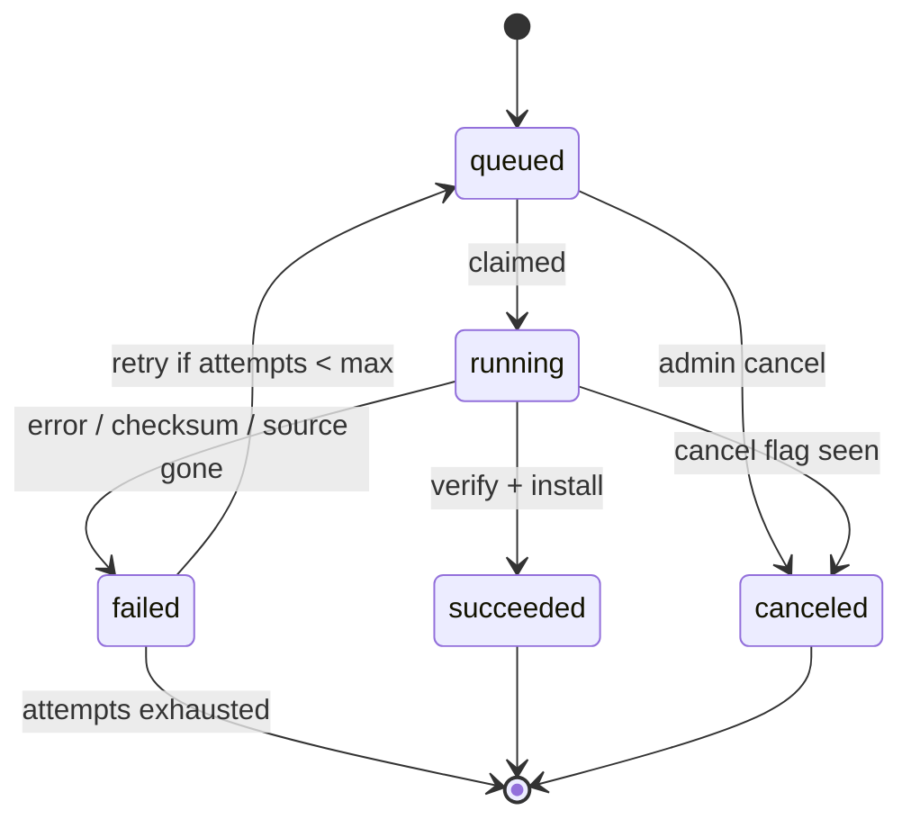
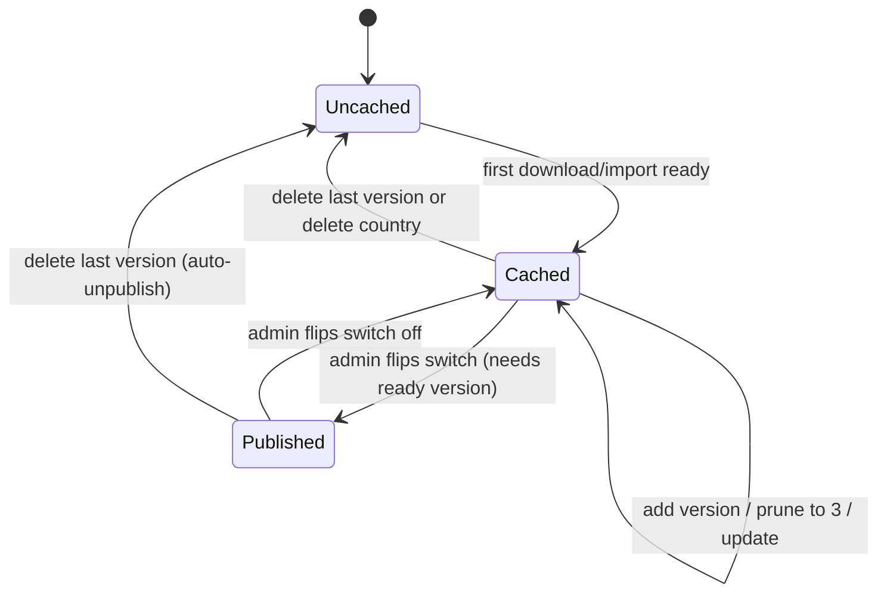
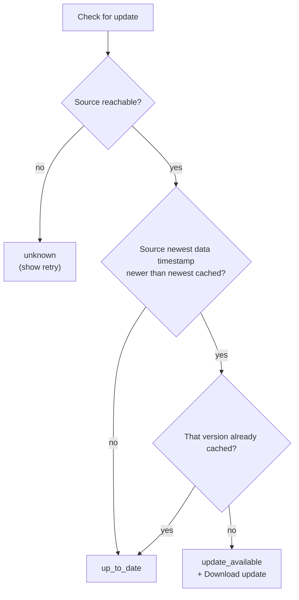
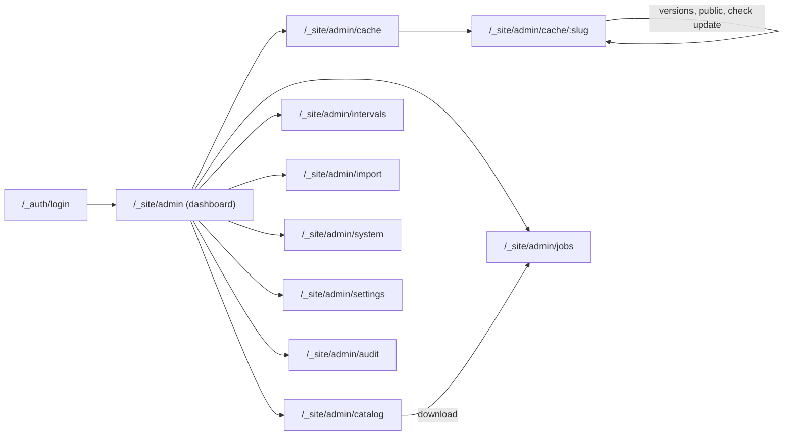
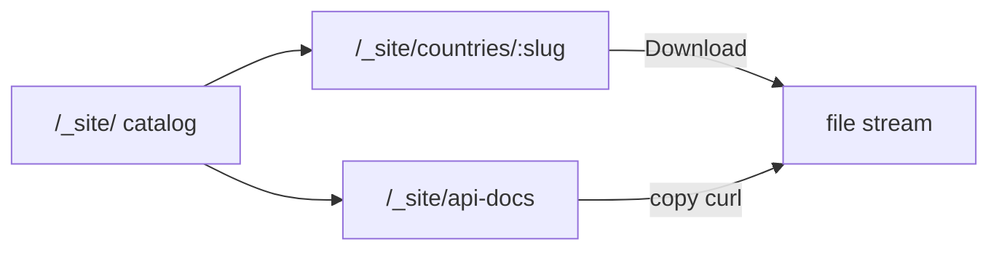

# 06 — Diagrams

All diagrams are Mermaid and render on GitHub. Update them with the code they describe.

## 1. System context



## 2. Container view



## 3. Deployment on Ubuntu 24.04



## 4. API namespace map



## 5. Data model (compact)



Full DDL: [`03-data-model.md`](03-data-model.md).

## 6. Job state machine



## 7. Cache lifecycle per country



## 8. Update check decision



## 9. Interval scheduling timeline (daily 03:00 UTC)

```mermaid
gantt
  title Daily interval with keep=3
  dateFormat  YYYY-MM-DD HH:mm
  axisFormat  %m-%d %H:%M
  section Scheduled
  03:00 run (261023 kept) :2026-10-23 03:00, 5m
  03:00 run (261024 added) :2026-10-24 03:00, 5m
  03:00 run               :2026-10-25 03:00, 5m
  section Retention
  prune to newest 3        :2026-10-24 03:05, 1m
```

## 10. Admin SPA navigation



## 11. Public SPA navigation


