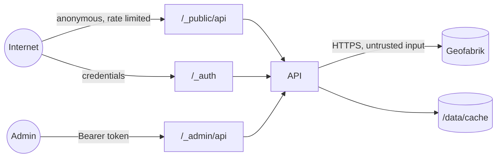

# 14 — Security

**TL;DR** — Argon2id + hashed opaque tokens, deny-by-default admin guard, slug-only file paths, strict CSP (no `v-html`), hashed download IPs, and a 20-item sign-off checklist for Phase 6.

Threat model for a self-hosted mirror that serves public files and holds an admin credential.

## 1. Assets

| Asset | Impact if compromised |
|---|---|
| Admin credentials / tokens | Full control: delete cache, publish data, change settings |
| Cached map artifacts | Integrity (poisoned map data), availability (deleted) |
| Disk / bandwidth | DoS by exhausting storage or saturating the link |
| Audit log | Accountability |
| Server (via uploads or path handling) | Remote code execution / file overwrite |

## 2. Trust boundaries



Trust nothing from: HTTP clients, multipart uploads, Geofabrik HTML/JSON responses, env values
(validate them), and file names.

## 3. Authentication & sessions

| Control | Implementation |
|---|---|
| Hashing | Argon2id (memory 64 MB, iterations 3, parallelism 1) with per-hash salt |
| Password policy | ≥ 12 chars, reject top-1000 weak list, reject username substring |
| Tokens | 256-bit random, `mm_` prefix, **SHA-256 hash stored**, constant-time compare, TTL 12 h |
| Revocation | Logout revokes one; password reset revokes all; expired rows pruned |
| Login throttling | ≤ 10 failures / 15 min per (ip, username) → `429` + `Retry-After` (a disabled account gets `403 ACCOUNT_LOCKED`), generic error messages |
| Transport | Bearer only over HTTPS (TLS terminated by proxy); no cookies, no query tokens |
| Storage in browser | `sessionStorage` only (D-13) — cleared on tab close |
| Enumeration | Same response and timing profile for unknown user vs wrong password |

## 4. Authorization

- Deny by default: the guard is registered for `/_admin/api/*` as a prefix hook; a new route is
  protected automatically (L2). `/_site/admin/*` pages are static shells — they hold no data, the
  guard on the API is what protects them.
- No role system in v1; the schema supports additional admins without code changes to the guard.
- Public read model applies `is_public = true AND status = 'ready'` in a single query layer so no
  endpoint can forget it (L8).

## 5. Input & file safety

| Risk | Control |
|---|---|
| Path traversal | Paths built only from validated `slug` + `version`; regex `^[a-z0-9][a-z0-9-]*$` / `^[A-Za-z0-9][A-Za-z0-9._-]*$`; final `realpath` must stay under `CACHE_DIR` |
| Malicious upload | Extension allow-list (`.osm.pbf`), size cap, PBF header/magic check, stream to temp, never execute, stored outside the web root |
| Zip bombs / weird formats | Not accepted (`.osm.pbf` only, uncompressed) |
| CSV/HTML injection in filenames | `Content-Disposition` filename is generated by us, not user input |
| Name/header injection in downloads | Only from DB values that already passed slug/version validation |
| Multipart abuse | Limits on parts/fields, temp file cleanup on abort, `proxy_request_buffering off` so bytes are not spooled twice, request timeout |
| Oversized JSON | Body limit 1 MB (uploads use multipart) |
| SSRF via source URL | Source base URL is a config value, not client input; only paths derived from validated region ids |
| SQL injection | Kysely parameterized queries only; no string concatenation of user input |
| XSS | Vue auto-escaping, **no `v-html`** anywhere (D-13); CSP header allows self + data: images |
| CSRF | Not applicable for Bearer + JSON APIs (no cookies, no ambient credentials) |
| Open redirect | No redirect endpoints; `/` redirect target is a constant |

## 6. Transport & headers

```
Content-Security-Policy: default-src 'self'; img-src 'self' data:; style-src 'self' 'unsafe-inline';
  script-src 'self'; connect-src 'self'; font-src 'self'; object-src 'none'; frame-ancestors 'none';
  base-uri 'none'; form-action 'self'; manifest-src 'self'; upgrade-insecure-requests
X-Content-Type-Options: nosniff
X-Frame-Options: DENY
Referrer-Policy: strict-origin-when-cross-origin
Permissions-Policy: geolocation=(), camera=(), microphone=()
Cross-Origin-Opener-Policy: same-origin
Strict-Transport-Security: max-age=31536000; includeSubDomains   # set at the TLS proxy
```

- `style-src 'unsafe-inline'` is required by Vuetify's runtime style injection; it is the **only**
  relaxation, and `script-src` stays strict (no `unsafe-inline`, no `unsafe-eval`).
- CORS: same-origin by default; `CORS_ORIGINS` allows an explicit allow-list only (no `*` when
  credentialed endpoints exist).
- Downloads: `Content-Type: application/x-protobuf`, `X-Content-Type-Options: nosniff`.

## 7. Rate limiting & abuse

| Endpoint | Limit |
|---|---|
| `POST /_auth/api/login` | 10 / 15 min per IP (+ per-username counter) |
| `/_public/api/countries*` | 60 / min per IP |
| `/_public/api/countries/:slug/download` | 10 / min per IP (counted at request start, stream not interrupted) |
| `/_admin/api/*` | 600 / min per token (protects against runaway UI loops) |
| Uploads | 1 concurrent / admin, size cap |

Responses include `Retry-After`. Limits are in-memory per instance (single container by design); the
in-memory limiter resets on restart, which is acceptable at this scale and documented.

## 8. Logging & privacy

- Redacted at the logger level: `authorization`, `cookie`, `set-cookie`, `password`, `token`.
- Never log full tokens, password hashes, or raw upload content.
- Public download events store `sha256(ip + IP_HASH_SALT)`, never the raw IP.
- Cached artifacts contain no OSM user metadata (Geofabrik public extracts omit `user`/`uid`/
  `changeset`), so MapMirror holds no PII from map data.
- Audit log retains actor name snapshot, action, target, and timestamps.

## 9. Dependency & supply chain

- `bun.lock` committed; installs are frozen in Docker (`bun install --frozen-lockfile`).
- Pinned base images (`oven/bun:1.x`, `nginx:1.x-alpine`, `postgres:16.x`), non-root runtime user.
- `bun audit` in the release checklist; no high/critical at release.
- No postinstall scripts from untrusted packages; review new dependencies (must be justified by an ADR
  if they are large or replace 20 lines of code).

## 10. Operations

- `.env` mode `600`, never committed, secrets via Docker secrets when possible.
- Database not exposed publicly; only `api` and `web` in `compose.yaml` publish ports.
- Backups contain the DB (credentials hashed) — store them with the same care as the DB.
- `ADMIN_PASSWORD` is only used at bootstrap and never re-read afterwards; reset via the script.
- Regular tasks: check `/_admin/api/system/status` for disk headroom, review failed jobs, review audit
  log for unexpected actions.

## 11. Security checklist (Phase 6 sign-off)

- [ ] Admin password ≥ 12 chars enforced, weak list rejected, Argon2id verified
- [ ] Token hash-only storage confirmed in DB inspection
- [ ] Every `/_admin/api/*` route returns 401 without a token (law test)
- [ ] Cookie auth, query-token auth, and Basic auth all rejected
- [ ] Logout revokes; password reset revokes all sessions
- [ ] No JWT anywhere (tokens are opaque): the client never decodes or trusts token contents
- [ ] Path traversal attempts rejected (unit test with `../`, absolute paths, URL-encoded input)
- [ ] Upload validation: extension, magic bytes, size cap, temp cleanup
- [ ] `Content-Disposition` uses a generated filename only
- [ ] Security headers present on HTML and API responses
- [ ] CSP has no `unsafe-eval`; no `v-html` in the codebase
- [ ] Rate limits verified with a loop test (login, public download)
- [ ] Unpublished country returns 404 on all public endpoints
- [ ] Public payloads contain no `storage_path`, job ids, admin ids, or IP data
- [ ] Secrets absent from git history (`git log -p | grep -i password` sanity check)
- [ ] Error responses expose no stack traces (`NODE_ENV=production`)
- [ ] Non-root containers verified (`docker compose exec api id`)
- [ ] DB not reachable from the host in production compose
- [ ] `bun audit` clean; base images pinned
- [ ] Backup/restore drill completed without exposing secrets
