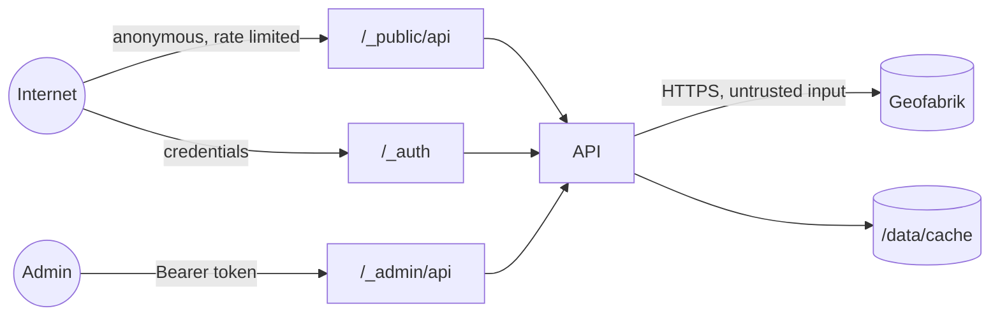

# 14 — Security

**TL;DR** — Argon2id + hashed opaque tokens, deny-by-default admin guard, slug-only file paths, strict CSP (no `v-html`), hashed download IPs, and a 20-item sign-off checklist for Phase 6.

Threat model for a self-hosted mirror that serves public files and holds an admin credential.

## 1. Assets

| Asset | Impact if compromised |
|---|---|
| Admin credentials / tokens | Full control: delete cache, publish data, change settings |
| Cached map artifacts | Integrity (poisoned map data), availability (deleted) |
| Disk / bandwidth | DoS by exhausting storage or saturating the link |
| Audit log | Accountability |
| Server (via uploads or path handling) | Remote code execution / file overwrite |

## 2. Trust boundaries



Trust nothing from: HTTP clients, multipart uploads, Geofabrik HTML/JSON responses, env values
(validate them), and file names.

## 3. Authentication & sessions

| Control | Implementation |
|---|---|
| Hashing | Argon2id (memory 64 MiB, iterations 3, parallelism 1) with per-hash salt |
| Password policy | ≥ 12 chars (code points in both submitted and NFKC-normalised forms), ≤ 256 submitted code points (the login schema's own limit), reject top-1000 weak list (case-folded, trailing digits/symbols stripped), reject username substring, reject surrounding whitespace. Enforced where passwords are **created**, not on login. No composition rules (NIST SP 800-63B) — see ADR-025 |
| Tokens | 256-bit random (`randomBytes(32)`), `mm_` prefix, **SHA-256 hash stored** — the token itself is never persisted, logged or echoed. Verified by an indexed probe on the digest, so no secret is ever compared in application code (a constant-time compare would guard nothing: the value compared is the one the database just matched). `token_prefix` is display-only and never a lookup key. TTL 12 h (`AUTH_TOKEN_TTL_HOURS`) |
| Revocation | **Implemented** (`POST /_auth/api/logout`, `P1-AUTH-04`): revokes **only the presented token** — signing out on one device leaves the others working, and "sign out everywhere" is what a password reset does. The revocation and its `auth.logout` audit row commit in **one transaction**, so an audit write that fails leaves the session alive and answers `500` instead of ending a session with no record of it. The revocation result decides the answer, not the verification before it: two logouts arriving together produce one `204` and one `401 TOKEN_REVOKED`, and one audit row (a handler that trusted its own verification answered `204` twice and wrote two rows — measured, pass 24). `revoked_at` keeps its first value, so a later request cannot rewrite when the session ended. Password reset (`scripts/reset-admin-password.ts`, `P1-AUTH-07`) revokes **all** of the account's open tokens in the **same transaction** as the new hash and the `auth.password_reset` audit row, so a reset that half-applied cannot leave a live session holding a password the operator believes is dead; other accounts are untouched, an already-revoked token keeps its first `revoked_at`, and the count is reported. A generated replacement is 24 characters from a lookalike-free alphabet, checked by the same policy as any other password, and printed exactly once, after the commit. Rows expired > 30 days are pruned after boot |
| Bearer header parsing | `modules/auth/session.ts`, used by `/me`, `/logout` and (from `P1-AUTH-05`) every `/_admin/api/*` request: exactly one scheme (`Bearer`, case-insensitive) followed by exactly one credential, optional whitespace allowed around it. `Bearer  token`, `Basic …`, `Bearer a b`, a bare token and a missing header are all `401 UNAUTHENTICATED`; the credential is passed on **verbatim** (lower-casing or trimming it would hash to a digest no row holds). The verdict-to-error mapping lives in the same module, so `/me` and the admin guard cannot disagree about whether a token is expired, revoked or belongs to a disabled account |
| Login throttling | ≤ 10 failures / 15 min per (ip, username) → `429` **with `details.lockedUntil`, `details.retryAfterSeconds` and a matching `Retry-After` header** (a disabled account gets `403 ACCOUNT_DISABLED` — not `ACCOUNT_LOCKED`, which read like throttling), generic error messages. **Implemented** (`modules/auth/login-throttle.ts`, `P1-AUTH-03`): a sliding window of failure instants rather than a fixed one, so there is no boundary at which an attacker gets `2N` attempts; a second **per-IP** counter at 3× the pair limit, which is what catches spraying one password across many usernames (each pair fails once — invisible to a per-pair counter); a successful login clears the **pair** counter only, because one valid login proves nothing about attempts on other accounts from the same address; unparseable addresses share a single `null` bucket instead of minting a fresh one per request (pass 22); and the map is bounded at 10 000 keys, pruning expired keys before evicting live ones, because an unbounded limiter is a memory-exhaustion lever aimed at the endpoint it protects. An attempt **reserves** its slot before the password is verified and gives it back when it settles, so a burst of simultaneous requests cannot all pass the same empty counter and each buy a full Argon2 verify (pass 28: 40 concurrent attempts, 40 hashes, zero `429`s before the fix; `401`×10 + `429`×30 after it) |
| Login response headers | `cache-control: no-store` on **every** answer in the `/_auth/api/*` namespace, including errors, and never a `set-cookie`: the token travels in the body only. The header is set by a hook on the namespace, before any handler or error path, so a response cannot leave without it — a cached login answer is a session handed to the next visitor |
| Validation of the login body | The **shared** Zod schema (`@mapirror/shared`), parsed in the handler; failure throws the `ZodError` and the one error handler maps it to `400 VALIDATION_ERROR` with `details.issues[].path`. Bounds are 1–64 for the username and 1–256 for the password — deliberately **not** the password policy, so an account created under an older policy still logs in and a too-short password is not distinguished from a wrong one |
| Transport | Bearer only over HTTPS (TLS terminated by proxy); no cookies, no query tokens |
| Storage in browser | `sessionStorage` only (D-13) — cleared on tab close. Every API request is sent with `credentials: 'omit'` (`apps/web/src/api/client.ts`), so the browser attaches no cookie and accepts no `set-cookie` — the `same-origin` default would do both, because the SPA and the API share an origin behind nginx, and that is the ambient credential the CSRF row below depends on not existing (pass 33) |
| Client address | `request.ip` is an **unvalidated forwarded header** when a proxy is trusted (`X-Forwarded-For: not-an-ip` arrives verbatim, measured). Parsed by `lib/client-ip.ts` before it reaches `inet` or any rate-limit key: a port is stripped, only IPv4/IPv6 literals are kept, anything else is stored as `null`. Without this, a junk header is a `500` on login and a fresh rate-limit bucket per request |
| Enumeration | Same response and timing profile for unknown user vs wrong password |

## 4. Authorization

- Deny by default: **implemented** as a global `onRequest` hook (`plugins/auth-guard.ts`, `P1-AUTH-05`) keyed on
  `isAdminApiPath` from `@mapirror/shared` — the same predicate the route law uses, which decodes percent-escapes
  before classifying, so `/_admin/%61pi/…` is admin too. A route added next week is protected before its handler is
  written. There is **no opt-out**: the hook's only option is a verifier (tests only), and the L2 test walks the route
  table via `onRoute` and calls every admin route it finds, so the list cannot go stale.
- The guard runs in `onRequest`, **before the body is parsed**, so an unauthenticated request costs no JSON parse and
  can have no side effect. It answers with the standard envelope by *throwing*, through the one error path — a `401`
  from the guard and a `500` from a dead pool are shaped by the same function.
- An anonymous request to an admin path with no route (`/_admin/api`) or with an unknown one is `401`, not `404`:
  `onRequest` runs before routing, so the admin surface is not mappable without a token. With a valid token the same
  paths are honest `404`s.
- CORS preflights are answered by the `security` stage (`204`) before the guard is reached — the order in
  `plugins/order.ts` is `security`, `db`, `rate-limit`, `auth`, `routes`, and a test pins it. A browser cannot attach
  `Authorization` to a preflight, so a guard ahead of CORS would break every cross-origin admin call.
- `/_site/admin/*` pages are static shells — they hold no data, the guard on the API is what protects them.
- No role system in v1; the schema supports additional admins without code changes to the guard.
- Public read model applies `is_public = true AND status = 'ready'` in a single query layer so no
  endpoint can forget it (L8).

## 5. Input & file safety

| Risk | Control |
|---|---|
| Path traversal / symlink escape | `modules/storage/storage.ts` accepts only validated `<slug>/<version>/<filename>` identities or UUID `.partial/<job>.part` references; persisted paths must have exactly three validated components. Every parent is checked with `lstat` + canonical-path comparison, leaf opens use `O_NOFOLLOW`, parts install by same-volume rename, and cleanup unlinks only a named file or encountered link (never recursively follows one). The configured root may itself be an operator symlink; keep the cache volume writable only by the API service/operator to prevent hostile concurrent path replacement |
| Malicious upload | Extension allow-list (`.osm.pbf`), size cap, PBF header/magic check, stream to temp, never execute, stored outside the web root |
| Zip bombs / weird formats | Not accepted (`.osm.pbf` only, uncompressed) |
| CSV/HTML injection in filenames | `Content-Disposition` filename is generated by us, not user input |
| Name/header injection in downloads | Only from DB values that already passed slug/version validation |
| Multipart abuse | Limits on parts/fields, temp file cleanup on abort, `proxy_request_buffering off` so bytes are not spooled twice, request timeout |
| Oversized JSON | Body limit 1 MB, set as a Fastify instance option (uploads use multipart, with their own `MAX_UPLOAD_BYTES` cap); an oversized body answers `413 FILE_TOO_LARGE` |
| SSRF via source URL | Source base URL is a config value, not client input; only paths derived from validated region ids |
| SQL injection | Kysely parameterized queries only; no string concatenation of user input |
| XSS | Vue auto-escaping, **no `v-html`** anywhere (D-13); CSP header allows self + data: images |
| CSRF | Not applicable for Bearer + JSON APIs (no cookies, no ambient credentials) |
| Open redirect | No redirect endpoints; `/` redirect target is a constant |

## 6. Transport & headers

```
Content-Security-Policy: default-src 'self'; img-src 'self' data:; style-src 'self' 'unsafe-inline';
  script-src 'self'; connect-src 'self'; font-src 'self'; object-src 'none'; frame-ancestors 'none';
  base-uri 'none'; form-action 'self'; manifest-src 'self'; upgrade-insecure-requests
X-Content-Type-Options: nosniff
X-Frame-Options: DENY
Referrer-Policy: strict-origin-when-cross-origin
Permissions-Policy: geolocation=(), camera=(), microphone=()
Cross-Origin-Opener-Policy: same-origin
Strict-Transport-Security: max-age=31536000; includeSubDomains   # set at the TLS proxy
```

- `style-src 'unsafe-inline'` is required by Vuetify's runtime style injection; it is the **only**
  relaxation, and `script-src` stays strict (no `unsafe-inline`, no `unsafe-eval`).
- CORS: same-origin by default; `CORS_ORIGINS` allows an explicit allow-list only (no `*` when
  credentialed endpoints exist).
  - A **preflight** (`OPTIONS` + `Access-Control-Request-Method`) from an origin that is not on the list is
    refused with `403 FORBIDDEN`; from an allowed origin it is answered `204` with the allowed methods and
    headers (`authorization` among them, since the token is a header).
  - An **actual** request from an unlisted origin is **not** refused — it is answered and simply left without
    `access-control-allow-origin`, so the browser hides the body. Refusing it broke the same-origin case:
    browsers send `Origin` on same-origin `POST`/`PATCH`/`DELETE`, so the SPA's own login request was rejected
    by its own API. CORS is a browser-side read barrier, not an authorisation mechanism.
  - `Vary: Origin` on every response, so a cache cannot serve one origin's answer (or its refusal) to another.
- The API sets the six headers above; `Strict-Transport-Security` is the TLS proxy's (this process speaks plain
  HTTP on a private port and its headers are not what a browser sees).
- Downloads: `Content-Type: application/x-protobuf`, `X-Content-Type-Options: nosniff`.

### Client identity

Everything per-IP — the limits below, and the salted hashes stored for downloads — reads `request.ip`. Behind
the reverse proxy this document mandates, the socket address belongs to the **proxy**, so identity has to be
configured or every client collapses into one:

| `TRUST_PROXY` | Meaning |
|---|---|
| `loopback` (default) | Trust `X-Forwarded-For` only when the peer is local — the documented same-host Caddy/Nginx. A remote client cannot spoof its address, because its peer is not loopback |
| an address / CIDR / list | For a proxy in a container network, e.g. `172.16.0.0/12` |
| `none` | Trust nothing; only correct when the API is reached directly |

Two values are **refused at boot** because Fastify's behaviour for them is not what an operator expects:

- **a hop count (`1`, `2`)** — Fastify returns a trust function that is always false for numeric input; there is
  no error and no warning, so the proxy would look configured and do nothing.
- **`true` / `*`** — trusts every peer, which lets any client choose its own address and defeat both the limits
  and the hashes.

Without this setting the consequences are silent and security-relevant: `POST /_auth/api/login` at 10 attempts
per 15 minutes becomes a **global** budget, so one attacker locks every administrator out, and every hashed
download IP is identical, making per-visitor statistics meaningless.

## 7. Rate limiting & abuse

| Endpoint | Limit |
|---|---|
| `POST /_auth/api/login` | 10 / 15 min per (IP, username) pair, and 30 / 15 min per IP |
| `/_public/api/countries*` | 60 / min per IP |
| `/_public/api/countries/:slug/download` | 10 / min per IP (counted at request start, stream not interrupted) |
| `/_admin/api/*` | 600 / min per token (protects against runaway UI loops) |
| Uploads | 1 concurrent / admin, size cap |

A refusal is `429 RATE_LIMITED` with `details.lockedUntil`, `details.retryAfterSeconds` and a matching
`Retry-After` header — the same envelope the login throttle already used, emitted by one place
(`plugins/errors.ts`) so no route has to remember. Five rules keep the numbers honest:

- **A refused request is not counted.** Charging it would let a client that ignores `Retry-After` extend its own
  penalty for as long as it keeps knocking, and would make the `Retry-After` it was given a lie.
- **Download and read are separate windows.** A client downloading files cannot lock itself out of the country
  list, and a browsing loop cannot block a download.
- **The admin bucket is keyed on the token digest**, not the address, so one runaway tab cannot lock out another
  admin behind the same NAT — and it is charged only when a bearer is present: a request without one is refused
  by the guard for free (`401`), so an unauthenticated flood cannot spend anybody's allowance.
- **Preflights and probes are not charged.** A CORS `OPTIONS` is answered by the security stage before this hook
  runs; charging it would halve every browser's real allowance and could answer the preflight itself with `429`,
  which a browser reports as a CORS failure rather than as a rate limit.
- **The window slides.** A key's allowance returns as each request ages out (60 s after *that* request), not in a
  batch at the top of a minute, so a client at the boundary is not punished twice.

Limits are in-memory per instance (single container by design) and reset on restart, which is acceptable at this
scale and is why the numbers are per minute rather than a quota: they bound a runaway client, not a user.
`PUBLIC_DOWNLOADS_PER_MINUTE` is the one an operator can move; the table above states the default.

**The probes are the deliberate exception.** `/healthz` and `/readyz` are unauthenticated and unlimited, because
a container, a load balancer and an uptime monitor cannot supply a token and must not be throttled into reporting
an outage they invented. What that exposes is bounded and chosen: `/healthz` does no work, and `/readyz` costs
one `select 1` plus one small file write, returns only `"ok"`/`"fail"` per check, and never echoes a driver
message or a filesystem path. Keep `/readyz` off the public interface where the proxy allows it; the decision is
recorded here so a future reviewer does not "fix" the missing token check.

## 8. Logging & privacy

- Redacted at the logger level: `authorization`, `cookie`, `set-cookie`, `password`, `token`.
- Never log full tokens, password hashes, or raw upload content.
- Download events store `sha256(ip + IP_HASH_SALT)` when the validated client address is available, never the raw IP; the `IP_HASH_SALT` fallback is generated once and persisted in `settings`.
- Cached artifacts contain no OSM user metadata (Geofabrik public extracts omit `user`/`uid`/
  `changeset`), so MapMirror holds no PII from map data.
- Audit log retains actor name snapshot, action, target, and timestamps.

## 9. Dependency & supply chain

- `bun.lock` committed; installs are frozen in Docker (`bun install --frozen-lockfile`).
- Pinned base images (`oven/bun:1.x`, `nginx:1.x-alpine`, `postgres:16.x`), non-root runtime user.
- `bun audit` in the release checklist; no high/critical at release.
- No postinstall scripts from untrusted packages; review new dependencies (must be justified by an ADR
  if they are large or replace 20 lines of code).

## 10. Operations

- `.env` mode `600`, never committed, secrets via Docker secrets when possible.
- Database not exposed publicly; only `api` and `web` in `compose.yaml` publish ports.
- Backups contain the DB (credentials hashed) — store them with the same care as the DB.
- `ADMIN_PASSWORD` is only used at bootstrap and never re-read afterwards; reset via the script.
- Regular tasks: check `/_admin/api/system/status` for disk headroom, review failed jobs, review audit
  log for unexpected actions.
- **A database failover must not restart the API.** A connection can be lost while it is idle *or* while it is
  serving a query or a transaction, and the two are reported differently: `pg-pool` keeps an `error` listener on a
  client only while it is idle in the pool and removes it on checkout. Both channels are now handled in
  `db/client.ts` (one line logged per lost connection, the pool reconnects on the next query), because the
  unchecked channel ended the process — see `16-changelog.md` pass 18.

## 11. Security checklist (Phase 6 sign-off)

- [ ] Admin password ≥ 12 chars enforced, weak list rejected, Argon2id verified
- [ ] Token hash-only storage confirmed in DB inspection
- [x] Every `/_admin/api/*` route returns 401 without a token (law test, `P1-API-08`)
- [x] Cookie auth, query-token auth, and Basic auth all rejected (`P1-API-08`: a live token offered in each place)
- [x] Logout revokes; password reset revokes all sessions (`P1-AUTH-04`, `P1-AUTH-07`)
- [ ] No JWT anywhere (tokens are opaque): the client never decodes or trusts token contents
- [ ] Path traversal attempts rejected (unit test with `../`, absolute paths, URL-encoded input)
- [ ] Upload validation: extension, magic bytes, size cap, temp cleanup
- [ ] `Content-Disposition` uses a generated filename only
- [ ] Security headers present on HTML and API responses
- [ ] CSP has no `unsafe-eval`; no `v-html` in the codebase
- [x] Rate limits verified with a loop test (login, public download) — `login-route.spec.ts` (burst, `401`×N then `429`) and `rate-limit.spec.ts` (public reads, downloads, admin token; the download bucket proved separate by pointing it at the read window)
- [ ] Unpublished country returns 404 on all public endpoints (`P3-TST-01` matrix added; awaiting a fresh PostgreSQL run)
- [ ] Public payloads contain no `storage_path`, job ids, admin ids, or IP data
- [ ] Secrets absent from git history (`git log -p | grep -i password` sanity check)
- [ ] Error responses expose no stack traces (`NODE_ENV=production`)
- [ ] Non-root containers verified (`docker compose exec api id`)
- [ ] DB not reachable from the host in production compose
- [ ] `bun audit` clean; base images pinned
- [ ] Backup/restore drill completed without exposing secrets
